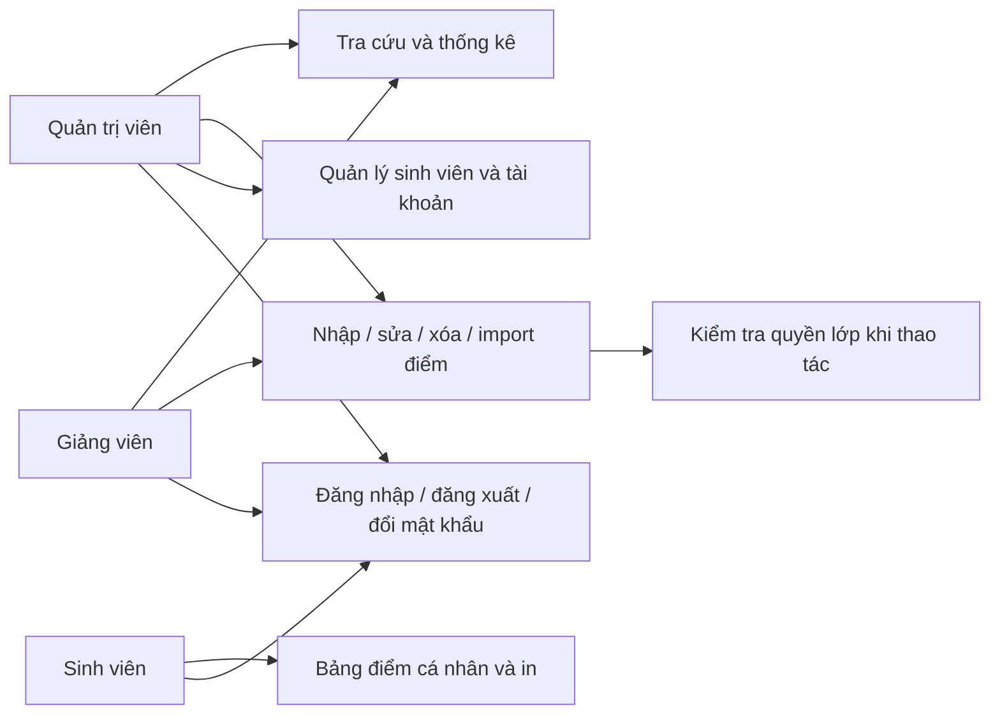
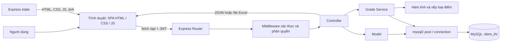
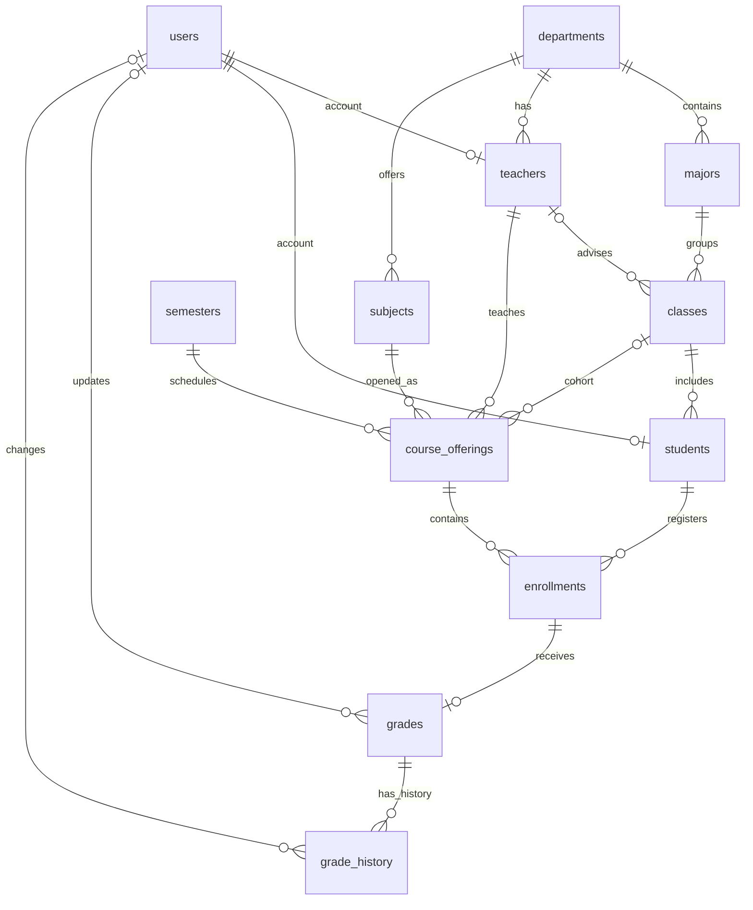
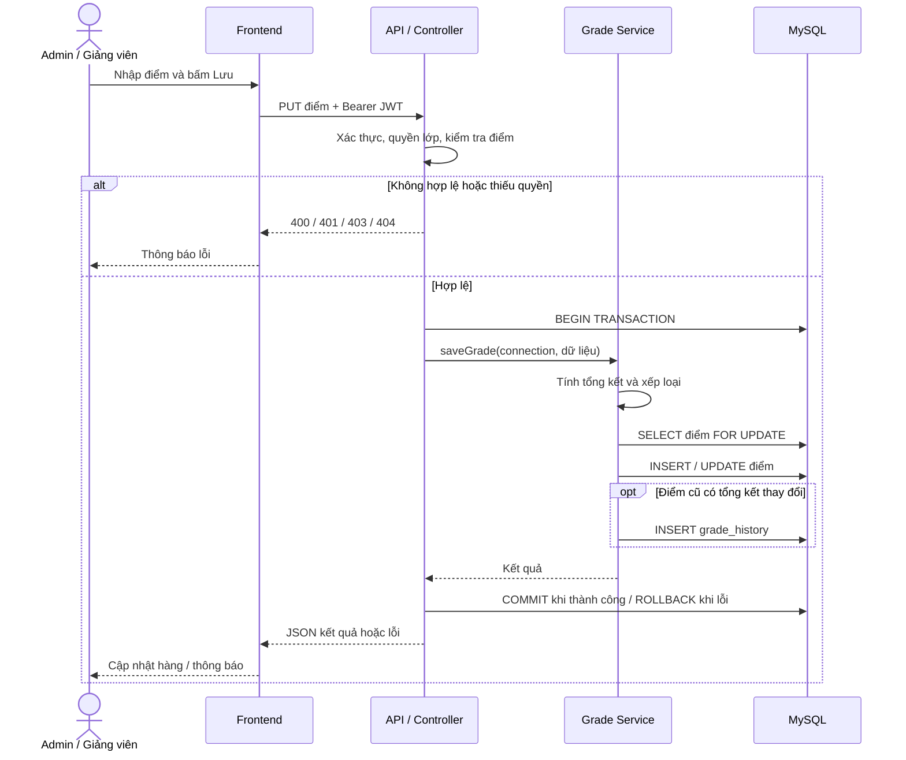

# MẪU SLIDE THUYẾT TRÌNH DỰ ÁN WEBSITE

> **Cập nhật 08/11/2026:** Dự án hiện chỉ dùng React. Nội dung mô tả frontend cũ, yêu cầu giữ bản cũ và kết quả rollback bên dưới là hồ sơ lịch sử trước khi gỡ bản cũ, không phải hướng dẫn chạy hiện hành. Xem [README](../README.md), [frontend React](../fe-react/README.md) và [slide React 12–22](./noi-dung-slide-12-22.md). Các liên kết mã frontend cũ trỏ tới commit lưu trữ.

> **Dự án:** Website Tra cứu Kết quả Thi Trực tuyến.  
> **Ngày trích xuất:** 30/10/2026.  
> **Căn cứ:** Mã nguồn frontend, backend, schema, dữ liệu SQL mẫu và tài liệu trong repository hiện tại. Nội dung được tổ chức theo đúng 15 slide yêu cầu, có chi tiết kỹ thuật để dùng làm ghi chú thuyết trình.  
> **Quy ước:** `[CẦN BỔ SUNG]` là thông tin chưa xác minh được. “Đã triển khai” nghĩa là có mã nguồn tương ứng; không đồng nghĩa toàn bộ chức năng đã vượt qua kiểm thử thực tế. Số lượng dữ liệu bên dưới được đếm từ các tệp seed SQL, không phải truy vấn một CSDL đang chạy. Hình chụp giao diện được đề xuất vị trí chèn, chưa có ảnh chụp mới trong lần trích xuất này.

## SLIDE 1 — GIỚI THIỆU ĐỀ TÀI

**WEBSITE TRA CỨU KẾT QUẢ THI TRỰC TUYẾN**

Đồ án môn học: **Lập trình Web**

- Giảng viên hướng dẫn: **[CẦN BỔ SUNG: tên giảng viên]**.
- Sinh viên/Nhóm thực hiện: **[CẦN BỔ SUNG: họ tên, mã sinh viên của từng thành viên]**.
- Lớp: **[CẦN BỔ SUNG: tên lớp học phần]**.
- Trường/Học viện: **[CẦN BỔ SUNG: tên cơ sở đào tạo chính thức]**.
- Năm học: **[CẦN BỔ SUNG: năm học thực hiện đồ án]**.

**Giới thiệu ngắn về sản phẩm**

Website hỗ trợ tra cứu và quản lý kết quả học tập theo sinh viên, môn học và học kỳ. Hệ thống có ba vai trò: quản trị viên, giảng viên và sinh viên; tích hợp nhập điểm, import Excel, bảng điểm cá nhân, thống kê và lịch sử thay đổi điểm tổng kết.

Tên đề tài trên lấy theo tài liệu gốc và tiêu đề website. “Cổng học vụ” là nhãn xuất hiện tại trang đăng nhập; dữ liệu trường, lớp và tài khoản demo không được dùng để suy ra thông tin nhóm thực hiện.

**Hình minh họa:** Logo sẵn có bên dưới; chèn thêm ảnh trang Tổng quan sau khi đăng nhập.


**Nguồn đối chiếu:** [README dự án](../README.md), [khung trang và tiêu đề website](https://github.com/Qangter/ltw_new2/blob/086ee19dbab7f6afbe2a85875579f006c23a09a2/fe/index.html), [giao diện đăng nhập](https://github.com/Qangter/ltw_new2/blob/086ee19dbab7f6afbe2a85875579f006c23a09a2/fe/pages/login.html).

---

## SLIDE 2 — ĐẶT VẤN ĐỀ VÀ LÝ DO CHỌN ĐỀ TÀI

**Bối cảnh**

- Trong hoạt động đào tạo, kết quả học tập liên quan đồng thời đến sinh viên, lớp, môn học, học kỳ và giảng viên phụ trách.
- Khi số lượng sinh viên và lớp học phần tăng, nhu cầu tra cứu nhanh, tổng hợp điểm và kiểm soát việc cập nhật dữ liệu trở nên cần thiết.
- Ứng dụng web cho phép các nhóm người dùng truy cập một nguồn dữ liệu tập trung qua trình duyệt.

**Vấn đề đặt ra**

- Nếu điểm được lưu trong nhiều bảng tính riêng lẻ, người sử dụng phải tổng hợp thủ công và khó theo dõi phiên bản cập nhật.
- Sinh viên cần xem bảng điểm của mình, biết số tín chỉ đã đạt và điểm trung bình mà không phải tự tính lại.
- Giảng viên cần nhập điểm thuận tiện, có kiểm tra miền giá trị và giới hạn thao tác theo lớp được phân công.
- Quản trị viên cần quản lý hồ sơ sinh viên, tài khoản và quan sát tình hình đạt/rớt ở mức tổng hợp.
- Khi điểm thay đổi, hệ thống cần lưu thông tin điểm cũ, điểm mới và người chỉnh sửa để hỗ trợ đối chiếu.

**Giải pháp đề xuất**

Xây dựng website tra cứu kết quả thi với CSDL quan hệ tập trung, giao diện theo vai trò và API xử lý nghiệp vụ. Dữ liệu điểm được liên kết với lượt đăng ký lớp học phần; việc tính điểm, xếp loại và ghi lịch sử thực hiện tại backend. Website hỗ trợ cả nhập điểm trực tiếp và nhập từ Excel.

**Lý do chọn đề tài**

- Bài toán gần với môi trường học tập, có quy trình đủ rõ để minh họa một ứng dụng web hoàn chỉnh.
- Có thể vận dụng đồng thời thiết kế giao diện, JavaScript bất đồng bộ, API, xác thực, phân quyền và thiết kế CSDL.
- Có dữ liệu nhiều bảng để thực hành JOIN, thống kê, ràng buộc toàn vẹn và transaction.

**Ghi chú thuyết trình:** Các vấn đề quản lý bằng bảng tính ở trên là bối cảnh phân tích của đề tài; repository không chứa biên bản khảo sát một trường cụ thể hoặc số liệu đo mức tiết kiệm thời gian.

**Nguồn đối chiếu:** [mô tả và chức năng dự án](../README.md), [schema dữ liệu học vụ](../database/02_schema.sql), [nghiệp vụ lưu điểm](../be/services/gradeService.js).

---

## SLIDE 3 — MỤC TIÊU DỰ ÁN

**Mục tiêu tổng quát**

Phát triển ứng dụng web quản lý và tra cứu kết quả thi trực tuyến, giúp tập trung dữ liệu học tập và cung cấp chức năng phù hợp cho quản trị viên, giảng viên và sinh viên; đồng thời vận dụng kiến thức của môn Lập trình Web.

**Mục tiêu cụ thể**

- Xây dựng đăng nhập, đăng xuất, đổi mật khẩu và điều hướng theo ba vai trò.
- Cho phép sinh viên xem bảng điểm cá nhân, lọc theo học kỳ và xem tổng hợp kết quả.
- Hỗ trợ nhân sự tra cứu sinh viên theo mã/tên, lọc theo lớp và mở bảng điểm chi tiết.
- Nhập, sửa, xóa điểm; tính điểm tổng kết và xếp loại tự động; ghi lịch sử khi tổng điểm thay đổi.
- Hỗ trợ import Excel, báo số dòng thêm mới/cập nhật/lỗi và nội dung lỗi theo dòng.
- Quản lý hồ sơ sinh viên, trạng thái hoạt động tài khoản và đặt lại mật khẩu.
- Thống kê số lượng dữ liệu, điểm trung bình, tỷ lệ đạt/rớt và phân bố điểm chữ.
- Tổ chức backend theo routes, controllers, models và services; tách khung HTML khỏi phần lớn logic xử lý giao diện.
- Có giao diện thích ứng màn hình nhỏ, thông báo phản hồi và trạng thái chờ tải dữ liệu.

**Kết quả mong đợi**

Một website có thể minh họa chuỗi nghiệp vụ: **đăng nhập → chọn lớp học phần → ghi nhận điểm → tính kết quả → tra cứu bảng điểm → thống kê và đối chiếu lịch sử**.

**Tiêu chí đánh giá đề xuất**

- Công thức và ngưỡng xếp loại cho kết quả đúng với quy tắc của dự án.
- Backend từ chối thao tác không đủ quyền và dữ liệu điểm ngoài miền 0–10.
- Các trang hiển thị dữ liệu nhất quán sau khi cập nhật hoặc tải lại.
- Các ca sử dụng chính được kiểm thử theo ba vai trò trước buổi demo.

**Nguồn đối chiếu:** [các route API](../be/routes/), [xử lý giao diện](https://github.com/Qangter/ltw_new2/blob/086ee19dbab7f6afbe2a85875579f006c23a09a2/fe/js/app.js), [quy tắc điểm](../be/utils/grade.js).

---

## SLIDE 4 — PHẠM VI VÀ ĐỐI TƯỢNG SỬ DỤNG

**Đối tượng sử dụng**

| Đối tượng | Nhu cầu và phạm vi sử dụng hiện có |
|---|---|
| Sinh viên — `STUDENT` | Đăng nhập, xem bảng điểm của chính mình, lọc học kỳ, xem GPA thang 10 và tín chỉ đạt, in bảng điểm, đổi mật khẩu. |
| Giảng viên — `TEACHER` | Tra cứu sinh viên/bảng điểm, xem thống kê, nhập/sửa/xóa điểm và thêm sinh viên vào lớp học phần mình phụ trách, import điểm trong phạm vi giảng dạy. |
| Quản trị viên — `ADMIN` | Sử dụng các chức năng nghiệp vụ điểm ở phạm vi toàn hệ thống; quản lý hồ sơ sinh viên, khóa/mở khóa tài khoản và đặt lại mật khẩu. |

**Phạm vi chức năng**

- Cốt lõi: xác thực, phân quyền, tra cứu điểm, nhập/sửa điểm, import Excel và thống kê.
- Bổ trợ: in bảng điểm bằng trình duyệt, tải Excel mẫu, lọc và phân trang, lịch sử sửa điểm tổng kết, thông báo trạng thái.
- Quản trị: thêm/sửa/xóa có điều kiện đối với hồ sơ sinh viên; danh sách tài khoản, khóa/mở khóa, reset mật khẩu.
- Các danh mục khoa, ngành, lớp, môn, học kỳ và giảng viên có trong CSDL và dữ liệu mẫu; chưa có giao diện/API CRUD đầy đủ cho từng danh mục.
- Chưa có chức năng sinh viên tự đăng ký học phần, phúc khảo, phê duyệt/công bố điểm, học phí hoặc quản lý tuyển sinh.

**Ranh giới phân quyền cần trình bày chính xác**

- Khi đọc danh sách lớp học phần để nhập điểm và khi ghi/xóa điểm, giảng viên được kiểm tra quyền đối với lớp phụ trách.
- Tuy nhiên, API tra cứu sinh viên, bảng điểm theo ID, danh sách điểm, lịch sử điểm và thống kê hiện cho phép cả Admin/Giảng viên mà chưa lọc toàn bộ dữ liệu theo giảng viên.
- Vì vậy, không mô tả hệ thống hiện tại là “giảng viên chỉ xem được mọi dữ liệu của lớp mình”.

**Phạm vi kỹ thuật**

- Nền tảng: ứng dụng web; frontend dạng SPA dùng hash route.
- Môi trường mục tiêu: trình duyệt hiện đại, Node.js và MySQL 8.x.
- Hình thức triển khai được hướng dẫn: localhost, địa chỉ mặc định `http://localhost:3000`.
- Express phục vụ cả tệp frontend tĩnh và API; chưa có cấu hình hosting/cloud công khai trong repository.
- Quy mô dữ liệu mẫu: 500 sinh viên, 25 giảng viên, 35 lớp, 38 môn, 6 học kỳ, 153 lớp học phần và 12.326 bản ghi điểm.
- Dữ liệu là mô phỏng phục vụ đồ án; số bản ghi không chứng minh khả năng chịu tải đồng thời.

**Nguồn đối chiếu:** [route sinh viên](../be/routes/students.js), [route điểm](../be/routes/grades.js), [kiểm tra quyền lớp](../be/controllers/gradesController.js), [truy vấn thống kê](../be/models/statsModel.js), [hướng dẫn dữ liệu](../database/README.md).

---

## SLIDE 5 — PHÂN TÍCH YÊU CẦU HỆ THỐNG

**1. Yêu cầu chức năng**

| Mã | Yêu cầu | Cách đáp ứng trong mã nguồn |
|---|---|---|
| F01 | Đăng nhập và xác định người sử dụng | So sánh mật khẩu bcrypt, kiểm tra tài khoản hoạt động, cấp JWT; API lấy thông tin người dùng hiện tại. |
| F02 | Bảo vệ quyền truy cập | Middleware xác thực JWT và kiểm tra role; kiểm tra giảng viên phụ trách tại thao tác lớp/điểm. |
| F03 | Tra cứu kết quả cá nhân | Sinh viên được xác định từ tài khoản trong JWT; trả bảng điểm, tín chỉ và GPA theo bộ lọc học kỳ. |
| F04 | Tra cứu sinh viên | Tìm mã/họ tên, lọc lớp, phân trang và mở bảng điểm chi tiết. |
| F05 | Quản lý điểm | Nhập ba thành phần điểm, tính tổng kết, xếp loại, lưu thay đổi, xóa điểm và xem lịch sử. |
| F06 | Nhập điểm hàng loạt | Đọc worksheet đầu tiên từ Excel, kiểm tra dữ liệu, xử lý từng dòng và trả báo cáo kết quả. |
| F07 | Thống kê học tập | Tổng quan; thống kê theo môn, học kỳ; phân bố điểm chữ; số sinh viên theo khoa. |
| F08 | Quản lý hồ sơ sinh viên | Thêm sinh viên cùng tài khoản, sửa hồ sơ, xóa khi không bị dữ liệu liên quan ràng buộc. |
| F09 | Quản lý tài khoản | Tìm kiếm/lọc role, khóa/mở khóa, đặt lại mật khẩu; không cho Admin tự khóa chính mình. |
| F10 | Hỗ trợ thao tác | Đổi mật khẩu, in bảng điểm, tải Excel mẫu, loading, toast và thông báo dữ liệu rỗng. |

**2. Yêu cầu phi chức năng**

- **Dễ sử dụng:** nhãn tiếng Việt, menu theo vai trò, bảng và bộ lọc theo nghiệp vụ.
- **Kiểm tra đầu vào:** điểm phải là số hữu hạn trong khoảng 0–10; điểm cuối kỳ bắt buộc; mã sinh viên tạo mới gồm 3–30 chữ/số; kiểm tra trường hồ sơ bắt buộc và giá trị enum.
- **Toàn vẹn dữ liệu:** khóa chính/khóa ngoại, UNIQUE, CHECK; transaction khi tạo sinh viên kèm tài khoản và khi lưu điểm.
- **An toàn ở mức đồ án:** mật khẩu băm bcrypt, JWT hết hạn sau 8 giờ, truy vấn nhận tham số, gán dữ liệu văn bản bằng `textContent` tại các helper giao diện.
- **Giới hạn xử lý:** JSON tối đa 1 MB; file import tối đa 5 MB và 5.000 dòng; danh sách sinh viên/điểm giới hạn tối đa 100 bản ghi mỗi trang khi gọi API.
- **Khả năng bảo trì:** phân chia trách nhiệm backend theo lớp; tái sử dụng template, helper và service.
- **Khả năng thích ứng:** có media query tại 820 px, 520 px và CSS dành cho in; mức tương thích thực tế cần kiểm thử trên thiết bị mục tiêu.
- **Hiệu năng:** có phân trang, cache metadata/template và MySQL pool 10 kết nối; chưa có benchmark thời gian phản hồi hay kiểm thử tải.

**Hình minh họa — sơ đồ tác nhân và chức năng**



Đây là sơ đồ tóm tắt chức năng theo tác nhân, không phải bản vẽ UML Use Case đầy đủ.

**Nguồn đối chiếu:** [xác thực](../be/controllers/authController.js), [middleware](../be/middleware/auth.js), [controller sinh viên](../be/controllers/studentsController.js), [controller điểm](../be/controllers/gradesController.js), [server](../be/server.js), [CSS](https://github.com/Qangter/ltw_new2/blob/086ee19dbab7f6afbe2a85875579f006c23a09a2/fe/css/style.css).

---

## SLIDE 6 — CÁC CHỨC NĂNG CHÍNH

**Tổng quan các nhóm chức năng của website**

**Nhóm 1 — Chức năng dành cho người dùng**

- **Đăng nhập/đăng xuất:** tạo phiên bằng JWT, lưu token và thông tin người dùng trên trình duyệt; đăng xuất xóa trạng thái phiên phía frontend.
- **Bảng điểm của tôi:** sinh viên xem mã môn, tên môn, tín chỉ, học kỳ, giảng viên, các điểm thành phần, tổng kết, điểm chữ và kết quả đạt/không đạt.
- **Tổng hợp cá nhân:** số bản ghi môn đã có điểm, tổng tín chỉ, tín chỉ đạt, số môn không đạt và GPA có trọng số tín chỉ theo thang 10.
- **Lọc và in:** lọc bảng điểm theo học kỳ; dùng chức năng in của trình duyệt.
- **Tra cứu sinh viên:** Admin/Giảng viên tìm theo tên hoặc mã, lọc lớp, phân trang và mở bảng điểm chi tiết.

**Nhóm 2 — Chức năng quản lý**

- **Nhập/sửa điểm:** chọn học kỳ và lớp học phần; sửa trực tiếp từng hàng; lưu từng hàng hoặc tất cả hàng đã thay đổi.
- **Thêm sinh viên vào lớp học phần:** nhập mã sinh viên; kiểm tra tồn tại và ngăn đăng ký trùng một lớp học phần.
- **Danh sách điểm:** lọc theo từ khóa, học kỳ, môn, lớp, kết quả; xem số lần sửa và lịch sử tổng điểm.
- **Import Excel:** tải mẫu, chọn file, xử lý dữ liệu và hiển thị số dòng thêm mới/cập nhật/lỗi.
- **Tổng quan và thống kê:** số sinh viên/giảng viên/môn/lớp, số điểm, điểm trung bình, tỷ lệ đạt/rớt, thống kê theo môn/học kỳ, phân bố điểm chữ và sinh viên theo khoa.
- **Quản lý sinh viên — Admin:** thêm hồ sơ đồng thời tạo tài khoản STUDENT, sửa hồ sơ, xóa hồ sơ chưa có ràng buộc đăng ký/điểm.
- **Quản lý tài khoản — Admin:** tìm kiếm, lọc vai trò, khóa/mở khóa, đặt lại mật khẩu mặc định theo vai trò. Chưa có thao tác tạo mọi loại tài khoản hay thay đổi role qua giao diện này.

**Nhóm 3 — Chức năng hỗ trợ**

- Đổi mật khẩu với kiểm tra mật khẩu cũ; mật khẩu mới dài tối thiểu 6 ký tự.
- Hiển thị loading toàn cục, thông báo thành công/thất bại, trạng thái dữ liệu rỗng.
- Kiểm tra dữ liệu và chuyển lỗi API thành thông báo tiếng Việt.
- Hiển thị badge theo kết quả và trạng thái tài khoản/sinh viên.
- Phân trang danh sách; cache metadata và nội dung trang để tái sử dụng.

**Lưu ý nghiệp vụ:** Lịch sử hiện chỉ được thêm khi sửa một bản ghi đã có và điểm tổng kết thay đổi. Thay đổi điểm thành phần nhưng tổng điểm giữ nguyên không tạo lịch sử mới; tạo điểm lần đầu cũng không tạo bản ghi lịch sử trong service.

**Hình minh họa:** Dùng ba thẻ “Tra cứu”, “Quản lý”, “Hỗ trợ”; chèn ảnh bảng nhập điểm và hộp thoại lịch sử.

**Nguồn đối chiếu:** [menu và các view](https://github.com/Qangter/ltw_new2/blob/086ee19dbab7f6afbe2a85875579f006c23a09a2/fe/js/app.js), [các trang giao diện](https://github.com/Qangter/ltw_new2/blob/086ee19dbab7f6afbe2a85875579f006c23a09a2/fe/pages/), [nghiệp vụ lưu điểm](../be/services/gradeService.js), [quản lý tài khoản](../be/controllers/adminController.js).

---

## SLIDE 7 — CÔNG NGHỆ VÀ CÔNG CỤ SỬ DỤNG

**Frontend**

- **HTML5:** khung ứng dụng, biểu mẫu và các thẻ `<template>` cho hàng bảng/thành phần dùng lại.
- **CSS3:** biến màu, Flexbox, Grid, media query, modal, toast và hiệu ứng trạng thái.
- **JavaScript thuần:** xử lý DOM, sự kiện, định tuyến theo hash, `async/await`, `fetch`, `Promise.all`, `FormData` và `localStorage`.
- **Biểu đồ:** thanh tỷ lệ bằng CSS và biểu đồ vòng bằng `conic-gradient`; không có phụ thuộc Chart.js trong mã đã đọc.
- **Font:** Inter tải từ Google Fonts; có font hệ thống dự phòng.
- Không dùng React, Vue, Angular hoặc công cụ build frontend trong cấu trúc hiện tại.

**Backend**

| Công nghệ/thư viện | Phiên bản khai báo | Vai trò |
|---|---|---|
| Node.js | Không khóa phiên bản trong manifest | Môi trường chạy JavaScript phía server. |
| Express | `^4.19.2` | Định tuyến API, middleware, phục vụ frontend tĩnh. |
| mysql2 | `^3.11.0` | Truy vấn MySQL bằng Promise và connection pool. |
| jsonwebtoken | `^9.0.2` | Ký và xác minh JWT. |
| bcryptjs | `^2.4.3` | Băm, đối chiếu mật khẩu; mã tạo/đổi/reset dùng cost 10. |
| multer | `^1.4.5-lts.1` | Nhận file multipart, lưu tạm trong bộ nhớ và giới hạn dung lượng. |
| xlsx | `^0.18.5` | Đọc file bảng tính và tạo Excel mẫu. |
| dotenv | `^16.4.5` | Nạp cấu hình từ biến môi trường. |
| cors | `^2.8.5` | Thiết lập middleware CORS. |

Dấu `^` là khoảng phiên bản khai báo trong manifest, không phải khẳng định phiên bản chính xác của mọi môi trường cài đặt. Lần kiểm tra hàm nghiệp vụ khi trích xuất sử dụng Node.js **v22.19.0**.

**Lưu trữ dữ liệu**

- **MySQL 8.x:** CSDL `diem_thi`, bảng InnoDB, charset `utf8mb4`; lưu tài khoản, danh mục học vụ, đăng ký, điểm và lịch sử.
- **localStorage:** lưu `token` và `user` để khôi phục phiên trên trình duyệt; dữ liệu nghiệp vụ chính vẫn lấy qua API từ MySQL.
- **Cache trong bộ nhớ frontend:** metadata và HTML trang; không phải một CSDL riêng.

**Công cụ phát triển**

- **npm:** quản lý dependencies; có lệnh `start` và `dev`.
- **Git:** repository hiện có thư mục quản lý phiên bản.
- **MySQL CLI / MySQL Workbench:** được tài liệu dự án hướng dẫn dùng để nạp và kiểm tra SQL.
- **SQL kiểm tra dữ liệu:** có script kiểm tra số lượng, trùng mã, bản ghi mồ côi và miền điểm.
- **Trình soạn thảo:** workspace đang được làm việc trong VS Code; chưa có tài liệu xác nhận đây là công cụ duy nhất của cả nhóm.
- Không thấy cấu hình test runner tự động hoặc script `npm test` trong manifest hiện tại.

**Lý do lựa chọn công nghệ**

- JavaScript dùng ở cả client/server, phù hợp minh họa lập trình web trong phạm vi đồ án.
- HTML/CSS/JS thuần giúp thể hiện trực tiếp cách dựng DOM, gọi API và quản lý trạng thái.
- Express cho phép tổ chức tuyến API và middleware rõ ràng.
- MySQL phù hợp với quan hệ sinh viên–lớp học phần–điểm và các yêu cầu thống kê.
- Thư viện Excel hỗ trợ tiếp nhận cách nhập liệu quen thuộc từ bảng tính.

**Hình minh họa:** Logo HTML5, CSS3, JavaScript, Node.js, Express, MySQL và Git; chỉ dùng các công nghệ thực sự nêu trên.

**Nguồn đối chiếu:** [manifest backend](../be/package.json), [server](../be/server.js), [pool MySQL](../be/config/db.js), [frontend](https://github.com/Qangter/ltw_new2/blob/086ee19dbab7f6afbe2a85875579f006c23a09a2/fe/js/app.js), [hướng dẫn CSDL](../database/README.md).

---

## SLIDE 8 — KIẾN TRÚC TỔNG THỂ HỆ THỐNG

**Các thành phần của hệ thống**

**Frontend**

- Trình duyệt tải khung ứng dụng và tài nguyên tĩnh từ Express.
- Router đọc `location.hash`, dựng layout chung, lọc menu theo vai trò và gọi view tương ứng.
- View nạp HTML template, gửi yêu cầu tới `/api`, rồi gắn dữ liệu phản hồi vào DOM.
- Helper API tập trung gắn header `Authorization: Bearer <token>`, gửi JSON/FormData, xử lý lỗi và trạng thái loading.
- Khi API trả 401 trong phiên đang có token, frontend xóa phiên và đưa người dùng về trạng thái chưa đăng nhập.

**Backend/API**

- **Routes:** ánh xạ URL/phương thức HTTP tới controller.
- **Middleware:** xác thực JWT, kiểm tra vai trò và chuyển lỗi bất đồng bộ tới xử lý lỗi tập trung.
- **Controllers:** đọc request, kiểm tra dữ liệu/quyền nghiệp vụ, điều phối xử lý và trả response.
- **Services:** dùng chung nghiệp vụ tính/lưu điểm và ghi lịch sử.
- **Models:** truy vấn dữ liệu qua MySQL pool. Service lưu điểm cũng trực tiếp thực thi SQL bằng connection được controller truyền vào để cùng tham gia transaction.
- **Utilities:** chuẩn hóa điểm, tính tổng kết, xếp loại và kiểu lỗi HTTP.

**Data Storage**

- MySQL lưu dữ liệu nghiệp vụ lâu dài.
- Pool giới hạn 10 kết nối, cho phép tái sử dụng kết nối thay vì tạo mới cho mỗi truy vấn.
- Transaction giúp nhóm thao tác liên quan được commit hoặc rollback cùng nhau.

**Luồng hoạt động**

Người dùng → SPA → HTTP API → middleware → controller → model/service → MySQL → JSON phản hồi → cập nhật giao diện.

**Hình minh họa — sơ đồ kiến trúc thực tế**



**Các nhóm endpoint**

| Nhóm | Ví dụ | Mục đích |
|---|---|---|
| Xác thực | `POST /api/auth/login`, `GET /api/auth/me`, `POST /api/auth/change-password` | Phiên và mật khẩu. |
| Sinh viên | `GET /api/students`, `GET /api/students/me/transcript`, `GET /api/students/:id/transcript` | Danh sách và bảng điểm; có POST/PUT/DELETE cho Admin. |
| Lớp học phần | `GET /api/meta`, `GET /api/offerings`, `GET /api/offerings/:id/students`, `POST /api/offerings/:id/enroll` | Danh mục hỗ trợ và lớp nhập điểm. |
| Điểm | `PUT /api/grades/enrollment/:enrollmentId`, `GET /api/grades`, `DELETE /api/grades/:id`, `GET /api/grades/:id/history` | Ghi, tra cứu, xóa và lịch sử điểm. |
| Excel | `GET /api/import/template`, `POST /api/import/grades` | Mẫu và nhập bảng tính. |
| Thống kê | `GET /api/stats/overview`, `by-subject`, `by-semester`, `distribution`, `by-department` dưới cùng tiền tố `/api/stats/` | Dữ liệu tổng hợp. |
| Quản trị | `GET /api/admin/users`, `PATCH /api/admin/users/:id/active`, `POST /api/admin/users/:id/reset-password` | Quản lý tài khoản. |

Có **27 khai báo route API** trong năm module route; endpoint đăng nhập không yêu cầu JWT, các endpoint còn lại có xác thực.

**Nguồn đối chiếu:** [cấu hình server](../be/server.js), [routes](../be/routes/), [middleware](../be/middleware/auth.js), [service](../be/services/gradeService.js), [frontend](https://github.com/Qangter/ltw_new2/blob/086ee19dbab7f6afbe2a85875579f006c23a09a2/fe/js/app.js).

---

## SLIDE 9 — THIẾT KẾ VÀ TỔ CHỨC DỮ LIỆU

**Mục tiêu**

- Tổ chức dữ liệu theo cấu trúc học vụ: khoa → ngành → lớp → sinh viên.
- Tách môn học khỏi lớp học phần được mở theo học kỳ và giảng viên.
- Liên kết điểm với lượt đăng ký để xác định đúng sinh viên, môn và học kỳ.
- Giảm lặp tên sinh viên/môn/học kỳ trong bảng điểm; lấy thông tin liên quan qua JOIN.
- Duy trì tính nhất quán bằng khóa ngoại, ràng buộc dữ liệu và transaction.

**Các thực thể và thuộc tính quan trọng**

Tất cả 12 bảng đều có khóa chính `id` kiểu số nguyên không âm, tự tăng.

| Bảng | Vai trò | Thuộc tính tiêu biểu | Bản ghi seed |
|---|---|---|---:|
| `departments` | Khoa | `department_code`, `department_name` | 10 |
| `majors` | Ngành thuộc khoa | `department_id`, `major_code`, `major_name` | 20 |
| `users` | Tài khoản | `username`, `password_hash`, `full_name`, `role`, `is_active` | 526 |
| `teachers` | Hồ sơ giảng viên | `user_id`, `department_id`, `teacher_code`, `full_name`, `academic_title` | 25 |
| `classes` | Lớp sinh viên | `major_id`, `advisor_teacher_id`, `class_code`, `academic_year` | 35 |
| `students` | Hồ sơ sinh viên | `user_id`, `class_id`, `student_code`, `full_name`, `date_of_birth`, `admission_year`, `status` | 500 |
| `subjects` | Môn học | `department_id`, `subject_code`, `subject_name`, `credits` | 38 |
| `semesters` | Học kỳ | `semester_code`, `semester_name`, `academic_year`, `start_date`, `end_date`, `status` | 6 |
| `course_offerings` | Lớp học phần | `subject_id`, `semester_id`, `teacher_id`, `class_id`, `room`, `schedule`, `max_students` | 153 |
| `enrollments` | Đăng ký lớp học phần | `student_id`, `course_offering_id`, `enrollment_date`, `status` | 14.232 |
| `grades` | Điểm cho một lượt đăng ký | `enrollment_id`, `attendance_score`, `midterm_score`, `final_score`, `total_score`, `letter_grade`, `result`, `updated_by` | 12.326 |
| `grade_history` | Lịch sử thay đổi tổng điểm | `grade_id`, `old_score`, `new_score`, `old_result`, `new_result`, `changed_by`, `reason`, `changed_at` | 40 |

Số lượng trên được đếm trực tiếp từ các tệp seed SQL riêng trong lần trích xuất. `users` gồm một Admin, 25 tài khoản giảng viên và 500 tài khoản sinh viên theo bộ dữ liệu mẫu. Không phải mọi lượt đăng ký đều có điểm.

**Quan hệ giữa các thực thể**

- Một khoa có nhiều ngành, giảng viên và môn học; một ngành có nhiều lớp; một lớp có nhiều sinh viên.
- Mỗi hồ sơ sinh viên/giảng viên gắn với một tài khoản; `user_id` trong từng bảng hồ sơ là UNIQUE.
- Một môn có thể mở nhiều lớp học phần theo học kỳ; mỗi lớp học phần có một giảng viên phụ trách.
- Sinh viên và lớp học phần có quan hệ nhiều–nhiều thông qua `enrollments`.
- Mỗi lượt đăng ký có tối đa một bản ghi `grades`; mỗi bản ghi điểm có thể có nhiều dòng lịch sử.

**Khóa và ràng buộc**

- UNIQUE cho mã danh mục, tên đăng nhập, mã sinh viên, mã giảng viên và liên kết tài khoản hồ sơ.
- UNIQUE `(student_id, course_offering_id)` ngăn đăng ký trùng một lớp học phần.
- UNIQUE `grades.enrollment_id` ngăn tạo nhiều bảng điểm cho cùng một lượt đăng ký.
- CHECK tín chỉ từ 1 đến 4; ngày kết thúc học kỳ sau ngày bắt đầu; các điểm nằm trong khoảng 0–10.
- Điểm chuyên cần/giữa kỳ được phép NULL; điểm cuối kỳ và tổng kết bắt buộc, dùng `DECIMAL(4,2)`.
- Nhiều quan hệ dùng `ON DELETE RESTRICT` để ngăn xóa đối tượng có dữ liệu phụ thuộc.
- Xóa bản ghi điểm kéo theo xóa lịch sử của điểm đó do `grade_history.grade_id` dùng `ON DELETE CASCADE`.
- Chỉ mục phục vụ tìm tên, lọc lớp, học kỳ, giảng viên và kết quả; chưa có đo lường hiệu quả chỉ mục.

**Hình minh họa — ERD**



**Quy tắc tính GPA đang dùng**

`GPA thang 10 = Σ(điểm tổng kết × số tín chỉ) / Σ(số tín chỉ)`.

Tính trên các bản ghi đã có điểm sau khi lọc học kỳ; bao gồm cả môn không đạt. Kết quả làm tròn hai chữ số; chưa có điểm thì trả `null`. Mã hiện tại chưa chọn lần học cao nhất cho các trường hợp học lại và chưa quy đổi GPA sang thang 4.

**Nguồn đối chiếu:** [schema đầy đủ](../database/02_schema.sql), [các tệp dữ liệu mẫu](../database/), [truy vấn và tổng hợp bảng điểm](../be/models/studentModel.js).

---

## SLIDE 10 — QUY TRÌNH XỬ LÝ NGHIỆP VỤ

**Giới thiệu quy trình tiêu biểu: nhập/sửa điểm một sinh viên**

1. Admin/Giảng viên đăng nhập và mở chức năng **Nhập điểm**.
2. Chọn học kỳ, lớp học phần; frontend tải danh sách sinh viên đã đăng ký và điểm hiện có.
3. Người dùng nhập chuyên cần, giữa kỳ, cuối kỳ và chọn **Lưu**.
4. Frontend gửi `PUT /api/grades/enrollment/:enrollmentId` kèm JWT và dữ liệu điểm.
5. Backend xác thực, kiểm tra role, kiểm tra lượt đăng ký tồn tại và quyền đối với lớp học phần.
6. Chuẩn hóa điểm: trường trống tùy chọn thành NULL; chấp nhận dấu phẩy thập phân; từ chối dữ liệu không phải số hoặc ngoài 0–10; làm tròn hai chữ số.
7. Controller lấy connection và mở transaction; service tính tổng điểm, điểm chữ và kết quả.
8. Service tìm bản ghi điểm hiện có bằng `SELECT ... FOR UPDATE`. Nếu chưa có thì INSERT và đổi đăng ký từ `ENROLLED` sang `COMPLETED`; nếu đã có thì UPDATE và ghi lịch sử khi tổng điểm thay đổi.
9. Thành công thì commit và trả `id`, `total`, `letter`, `result`, `created`; lỗi thì rollback; connection luôn được trả về pool.
10. Frontend cập nhật tổng kết/xếp loại/kết quả ngay trên hàng, xóa dấu đánh dấu thay đổi và hiển thị thông báo.

**Quy tắc tính điểm**

- Khi có đủ điểm: **Tổng kết = 10% chuyên cần + 30% giữa kỳ + 60% cuối kỳ**.
- Nếu thiếu chuyên cần **hoặc** giữa kỳ: **Tổng kết = điểm cuối kỳ**.
- Điểm cuối kỳ bắt buộc; tổng kết làm tròn hai chữ số thập phân.
- Tổng kết từ 5 trở lên: `PASSED`; dưới 5: `FAILED`.

| Tổng kết | Điểm chữ | Kết quả |
|---|---|---|
| 9,00–10,00 | A+ | Đạt |
| 8,50 đến dưới 9,00 | A | Đạt |
| 8,00 đến dưới 8,50 | B+ | Đạt |
| 7,00 đến dưới 8,00 | B | Đạt |
| 6,50 đến dưới 7,00 | C+ | Đạt |
| 5,50 đến dưới 6,50 | C | Đạt |
| 5,00 đến dưới 5,50 | D | Đạt |
| Dưới 5,00 | F | Không đạt |

**Ví dụ:** chuyên cần 8, giữa kỳ 7, cuối kỳ 9 → `0,1 × 8 + 0,3 × 7 + 0,6 × 9 = 8,30` → B+ → Đạt. Đây là quy tắc của dự án, chưa đối chiếu quy chế điểm của một cơ sở đào tạo cụ thể.

**Các tình huống cần xem xét**

| Tình huống | Cách xử lý hiện có |
|---|---|
| Điểm hợp lệ, đủ quyền | Lưu trong transaction và trả kết quả tính toán. |
| Bỏ trống cuối kỳ, nhập 11 hoặc ký tự | Trả lỗi 400, không lưu điểm. |
| Thiếu/sai/hết hạn JWT | Trả 401; frontend xử lý lại phiên đăng nhập. |
| Giảng viên thao tác lớp khác | Trả 403 tại kiểm tra quyền lớp. |
| Lượt đăng ký/lớp học phần không tồn tại | Trả 404. |
| Lỗi khi ghi CSDL | Rollback; lỗi không được phân loại cụ thể trả thông báo 500 chung. |
| Lớp chưa có sinh viên hoặc không có lớp trong học kỳ | Hiển thị trạng thái rỗng tương ứng. |

**Hình minh họa — Sequence Diagram**



**Quy trình bổ sung: import Excel**

- Nhận trường multipart `file`, dung lượng tối đa 5 MB; đọc worksheet đầu tiên.
- File mẫu có 8 cột: `student_code`, `full_name`, `subject_code`, `subject_name`, `credits`, `semester_name`, `academic_year`, `score`.
- Backend kiểm tra sự hiện diện của 4 cột bắt buộc: `student_code`, `subject_code`, `semester_name`, `score`; tối đa 5.000 dòng.
- Với từng dòng: tìm sinh viên, môn và học kỳ bằng mã/tên; tìm lớp học phần phù hợp, giới hạn theo giảng viên nếu là TEACHER.
- Ưu tiên lớp mà sinh viên đã đăng ký; nếu chưa đăng ký thì tự tạo enrollment. Nếu có nhiều lớp phù hợp, mã chọn theo thứ tự đã đăng ký trước, rồi ID lớp tăng dần.
- Gọi cùng service lưu điểm với chuyên cần/giữa kỳ = NULL, cuối kỳ = `score`; vì vậy tổng kết bằng điểm nhập từ file. Import cập nhật điểm hiện có cũng đưa chuyên cần/giữa kỳ về NULL.
- Mỗi dòng có transaction riêng: dòng lỗi không hủy các dòng đã commit thành công.
- Trả `total`, `created`, `updated`, `failed`; danh sách lỗi kèm số dòng Excel, tối đa 100 lỗi chi tiết. Số `updated` đếm bản ghi đã tồn tại được xử lý, kể cả tổng điểm không đổi.
- Các cột họ tên, tên môn, tín chỉ và năm học trong mẫu không được dùng để tự tạo/cập nhật danh mục; sinh viên/môn/học kỳ phải tồn tại trước.

**Nguồn đối chiếu:** [controller điểm và import](../be/controllers/gradesController.js), [service lưu điểm](../be/services/gradeService.js), [hàm tính điểm](../be/utils/grade.js), [model điểm](../be/models/gradeModel.js), [view nhập điểm](https://github.com/Qangter/ltw_new2/blob/086ee19dbab7f6afbe2a85875579f006c23a09a2/fe/pages/entry.html).

---

## SLIDE 11 — THIẾT KẾ GIAO DIỆN VÀ TRẢI NGHIỆM NGƯỜI DÙNG

**Định hướng thiết kế**

- Bố cục dùng chung sidebar và vùng nội dung chính; trang đăng nhập dùng thẻ biểu mẫu riêng.
- Màu chủ đạo xanh dương `#3b82f6`, nền sáng `#f1f5f9`, chữ đậm `#0f172a`; sidebar màu tối.
- Font Inter, cỡ chữ nền 14 px, có font dự phòng của hệ điều hành.
- Phân biệt trạng thái bằng badge và màu: đạt màu xanh, không đạt màu đỏ, vai trò/trạng thái có nhãn tiếng Việt.
- Nút và trường nhập có trạng thái hover/focus; thông báo và loading dùng thuộc tính hỗ trợ đọc trạng thái như `aria-live`.

**Các thành phần giao diện**

| Thành phần | Cách sử dụng |
|---|---|
| Sidebar/menu | Hiển thị chức năng theo vai trò, tên tài khoản, vai trò và đăng xuất; đánh dấu trang đang mở. |
| Thẻ thống kê | Số liệu tổng quan, tỷ lệ và kết quả cá nhân. |
| Bộ lọc/toolbar | Từ khóa, lớp, môn, học kỳ, kết quả hoặc vai trò tùy màn hình. |
| Bảng dữ liệu | Bảng điểm, nhập điểm inline, danh sách sinh viên/tài khoản; có vùng cuộn ngang. |
| Modal | Thêm/sửa hồ sơ sinh viên và xem lịch sử điểm. |
| Toast/loading/empty | Phản hồi thao tác, đồng bộ dữ liệu và trạng thái chưa có kết quả. |
| Biểu đồ | Thanh tỷ lệ, biểu đồ vòng và chú giải trực tiếp bằng HTML/CSS/JS. |
| Phân trang | Điều hướng danh sách với số trang và trạng thái trang hiện tại. |

**Các màn hình chính**

Đăng nhập; Tổng quan; Bảng điểm của tôi; Tra cứu sinh viên; Bảng điểm chi tiết; Nhập/sửa điểm; Import Excel; Danh sách điểm; Thống kê đạt/rớt; Quản lý sinh viên; Tài khoản; Đổi mật khẩu. Bảng điểm cá nhân và bảng điểm chi tiết dùng chung mẫu giao diện bảng điểm.

**Responsive Design**

- **Desktop:** sidebar bên trái rộng 248 px, vùng chính bên phải; các thẻ dùng Grid tự điều chỉnh số cột.
- **Từ 820 px trở xuống:** layout chuyển dọc, sidebar nằm phía trên, menu cuộn ngang; form hai cột chuyển thành một cột; giảm padding nội dung.
- **Từ 520 px trở xuống:** giảm kích thước/padding modal; biểu đồ vòng và chú giải xếp một cột.
- **Khi in:** ẩn sidebar, toolbar, toast và các phần tử có lớp không in; bỏ bóng thẻ.
- Có quy tắc giảm một số chuyển động theo `prefers-reduced-motion`.
- Cần kiểm tra thực tế các bảng rộng và bộ chọn lớp học phần ở màn hình hẹp; mã có responsive CSS chưa đủ để khẳng định mọi trang hiển thị hoàn hảo trên điện thoại.

**Hình minh họa:** Chèn ảnh thật của trang Tổng quan trên desktop, trang Nhập điểm và trang Bảng điểm trên mobile. Gợi ý chụp ở 1366×768 và 390×844; đây là kích thước đề xuất kiểm tra, chưa phải kết quả đã chụp.

**Nguồn đối chiếu:** [stylesheet](https://github.com/Qangter/ltw_new2/blob/086ee19dbab7f6afbe2a85875579f006c23a09a2/fe/css/style.css), [layout chung](https://github.com/Qangter/ltw_new2/blob/086ee19dbab7f6afbe2a85875579f006c23a09a2/fe/pages/shell.html), [các template dùng lại](https://github.com/Qangter/ltw_new2/blob/086ee19dbab7f6afbe2a85875579f006c23a09a2/fe/pages/common.html), [logic giao diện](https://github.com/Qangter/ltw_new2/blob/086ee19dbab7f6afbe2a85875579f006c23a09a2/fe/js/app.js).

---

## SLIDE 12 — TRIỂN KHAI VÀ HIỆN THỰC CHỨC NĂNG

**Quá trình phát triển — mô tả theo cấu trúc sản phẩm hiện có**

1. Thiết kế schema và bộ seed cho tài khoản, danh mục, đăng ký, điểm và lịch sử.
2. Tạo Express server, kết nối MySQL bằng pool và khai báo các module route.
3. Tách controller điều phối HTTP, model truy vấn, service lưu điểm và utility tính toán.
4. Xây dựng frontend SPA, layout dùng chung và các HTML template cho từng trang.
5. Kết nối giao diện với API, bổ sung form, bộ lọc, phân trang, import và thông báo.
6. Chuẩn bị truy vấn kiểm tra dữ liệu và kịch bản kiểm thử nghiệp vụ.

Đây là cách giải thích các phần hiện thực; repository không đủ bằng chứng để gán lịch trình hoặc người phụ trách cho từng bước.

**Hình minh họa — cấu trúc thư mục**

```text
ltw_new2/
├── README.md
├── be/
│   ├── server.js                 # Express, static frontend, xử lý lỗi
│   ├── package.json              # Dependencies và npm scripts
│   ├── config/db.js              # MySQL connection pool
│   ├── routes/                   # auth, students, grades, stats, admin
│   ├── controllers/              # Kiểm tra, điều phối request/response
│   ├── models/                   # Truy vấn dữ liệu
│   ├── services/gradeService.js  # Lưu điểm và lịch sử dùng chung
│   ├── middleware/auth.js       # JWT, role, wrapper lỗi
│   └── utils/grade.js            # Chuẩn hóa, tính, xếp loại điểm
├── fe/
│   ├── index.html               # Khung SPA
│   ├── assets/images/logo.png
│   ├── css/style.css
│   ├── js/app.js                # Router, API helper và các view
│   └── pages/                   # HTML trang, common và modals
├── database/
│   ├── 02_schema.sql
│   ├── full_setup.sql           # Script gộp tạo cấu trúc và dữ liệu
│   ├── generate.js              # Sinh bộ dữ liệu mẫu
│   ├── verify.sql               # Truy vấn kiểm tra dữ liệu
│   ├── example_queries.sql
│   ├── excel_template.xlsx
│   └── sample_grades.xlsx
└── docs/                        # Tài liệu giải thích và thuyết trình
```

**Một số điểm kỹ thuật nổi bật**

**1. Tách giao diện theo template**

Khung trang được tải bằng `fetch`, cache theo tên trang; các hàng bảng/thẻ được tạo bằng clone `<template>`. Helper gán dữ liệu dùng `textContent`, giúp tách dữ liệu khỏi HTML tại các vị trí hiển thị thông thường. JavaScript vẫn có một số chuỗi markup cho icon/loading; không nên khẳng định hoàn toàn không có HTML trong JavaScript.

**2. API helper và quản lý trạng thái phiên**

Một helper dùng chung quản lý JWT, JSON, FormData, file nhị phân và lỗi HTTP. Bộ đếm request đang chờ giúp loading không bị tắt sớm khi nhiều API chạy đồng thời. Token/user lưu trong localStorage; metadata và template cache trong bộ nhớ.

**3. Dùng chung nghiệp vụ lưu điểm**

Nhập thủ công và import Excel gọi cùng service để thống nhất cách tính tổng kết, xếp loại và ghi lịch sử. Controller quản lý transaction, service nhận connection để các truy vấn thuộc cùng giao dịch.

**4. Kiểm tra đồng thời ở ứng dụng và CSDL**

Backend kiểm tra miền điểm và role trước khi ghi. CSDL bổ sung CHECK, UNIQUE và FOREIGN KEY để bảo vệ ràng buộc dữ liệu. Tạo hồ sơ sinh viên và tài khoản được đặt trong cùng transaction để tránh tạo dở một trong hai bản ghi.

**5. Lưu các hàng đã chỉnh sửa**

Giao diện nhập điểm đánh dấu hàng bằng `data-dirty`; nút “Lưu tất cả thay đổi” chỉ gửi những hàng đã chỉnh sửa. Các yêu cầu được lưu tuần tự từng hàng, không phải một transaction cho toàn bộ bảng.

**Đoạn mã quan trọng — công thức điểm thực tế**

```javascript
function calcTotal(a, m, f) {
  if (a === null || m === null) return Math.round(f * 100) / 100;
  return Math.round((a * 0.1 + m * 0.3 + f * 0.6) * 100) / 100;
}
```

Tham số lần lượt là chuyên cần, giữa kỳ và cuối kỳ. Việc chuẩn hóa/kiểm tra đầu vào thực hiện trước khi gọi công thức này.

**Cách triển khai local**

1. Chuẩn bị Node.js/npm và MySQL; cấu hình một CSDL dành cho bản demo.
2. Nạp [script SQL tổng hợp](../database/full_setup.sql) bằng MySQL CLI hoặc MySQL Workbench.
3. Tạo cấu hình backend từ [tệp cấu hình mẫu](../be/.env.example), đặt các biến `DB_HOST`, `DB_PORT`, `DB_USER`, `DB_PASSWORD`, `DB_NAME`, `JWT_SECRET` và `PORT` nếu cần.
4. Trong [thư mục backend](../be/), chạy `npm install`, sau đó `npm start`; dùng `npm run dev` nếu cần Node watch mode.
5. Truy cập `http://localhost:3000`. Server kiểm tra `SELECT 1` trước khi lắng nghe, nên phải kết nối MySQL thành công.

**Trọng tâm trình bày:** Giải thích một thao tác đi từ view qua API tới transaction, thay vì chỉ đọc tên thư mục. Không đưa giá trị mật khẩu CSDL hay JWT secret thực tế vào slide.

**Nguồn đối chiếu:** [frontend](https://github.com/Qangter/ltw_new2/blob/086ee19dbab7f6afbe2a85875579f006c23a09a2/fe/js/app.js), [controller sinh viên](../be/controllers/studentsController.js), [service điểm](../be/services/gradeService.js), [utility điểm](../be/utils/grade.js), [hướng dẫn chạy](../README.md).

---

## SLIDE 13 — DEMO SẢN PHẨM

**Kịch bản demo đề xuất — khoảng 6–8 phút**

**Chuẩn bị**

- Server và MySQL đã chạy; dữ liệu demo đã được nạp.
- Chuẩn bị sẵn một sinh viên và lớp học phần có thể chỉnh sửa trong bản dữ liệu demo.
- Chuẩn bị một file Excel hợp lệ và một bản sao có một dòng điểm sai để minh họa báo lỗi.
- Chỉ minh họa cập nhật/xóa trên dữ liệu demo; phần dưới là kịch bản, chưa phải nhật ký thao tác đã thực hiện trong lần trích xuất.

| Vai trò | Tài khoản demo | Mật khẩu demo |
|---|---|---|
| Admin | `admin` | `admin123` |
| Giảng viên | `teacher01` đến `teacher25` | `teacher123` |
| Sinh viên | `student001` đến `student500` | `student123` |

Đây là tài khoản mẫu công khai trong README và trang đăng nhập. Theo bộ seed, `student001` gắn với mã `SV0001`.

**1. Giới thiệu giao diện tổng quan**

- Mở `http://localhost:3000`, giới thiệu logo và trang đăng nhập.
- Đăng nhập bằng Admin; giới thiệu sidebar, tên/vai trò, thẻ thống kê và biểu đồ.
- Giải thích các số liệu hiển thị được lấy từ API và CSDL.

**2. Minh họa chức năng chính**

- Đăng nhập giảng viên, mở **Nhập điểm**, chọn học kỳ có lớp phụ trách.
- Chọn một sinh viên trong lớp, nhập CC = 8, GK = 7, CK = 9 rồi lưu.
- Kết quả mong đợi theo công thức: tổng kết **8,30**, điểm chữ **B+**, trạng thái **Đạt**.
- Sửa CK thành 8 rồi lưu; kết quả mong đợi là **7,70**, điểm chữ **B**.
- Mở **Danh sách điểm**, tìm sinh viên và xem lịch sử để đối chiếu thay đổi tổng điểm.
- Đăng nhập tài khoản sinh viên tương ứng, mở **Bảng điểm của tôi**, lọc đúng học kỳ và quan sát điểm mới.

**3. Minh họa chức năng bổ sung**

- Tra cứu sinh viên theo mã/tên, lọc lớp và mở bảng điểm chi tiết.
- Mở Import Excel, tải file mẫu hoặc dùng [file mẫu dữ liệu](../database/sample_grades.xlsx); chọn file và quan sát báo cáo thêm mới/cập nhật/lỗi.
- Dùng Admin để minh họa form thêm/sửa sinh viên hoặc danh sách tài khoản và lọc role.
- Mở thống kê theo môn/học kỳ, giải thích điểm trung bình và tỷ lệ đạt.

**4. Kiểm tra xử lý lỗi**

- Bỏ trống điểm cuối kỳ: mong đợi thông báo cần nhập điểm cuối kỳ.
- Nhập điểm 11: mong đợi lỗi yêu cầu điểm từ 0 đến 10.
- Tìm mã sinh viên không tồn tại: mong đợi trạng thái không có kết quả.
- Import một dòng có mã sinh viên không tồn tại: mong đợi bảng lỗi có số dòng và nội dung tương ứng.
- Nếu demo phân quyền API: dùng token giảng viên để gọi thao tác nhập điểm lớp không phụ trách, mong đợi 403. Chỉ ẩn menu chưa đủ chứng minh bảo vệ API.

**5. Minh họa Responsive**

- Thu hẹp viewport xuống dưới 820 px để quan sát sidebar/menu chuyển bố cục.
- Chuyển về kích thước điện thoại khoảng 390 px, kiểm tra thẻ, form, modal và khả năng cuộn bảng.
- Tại bảng điểm, mở bản xem trước khi in để giới thiệu CSS dành cho in.

**Hình minh họa:** Chèn 4–6 ảnh thật: đăng nhập, tổng quan, nhập điểm, lịch sử, bảng điểm sinh viên, giao diện mobile. Đường dẫn localhost chỉ truy cập được khi môi trường demo đã chạy; chưa có URL website công khai được xác minh.

**Nguồn đối chiếu:** [tài khoản demo](../README.md), [trang nhập điểm](https://github.com/Qangter/ltw_new2/blob/086ee19dbab7f6afbe2a85875579f006c23a09a2/fe/pages/entry.html), [trang import](https://github.com/Qangter/ltw_new2/blob/086ee19dbab7f6afbe2a85875579f006c23a09a2/fe/pages/import.html), [bảng điểm](https://github.com/Qangter/ltw_new2/blob/086ee19dbab7f6afbe2a85875579f006c23a09a2/fe/pages/transcript.html), [file Excel mẫu](../database/sample_grades.xlsx).

---

## SLIDE 14 — KIỂM THỬ, KẾT QUẢ VÀ HƯỚNG PHÁT TRIỂN

**Kiểm thử hệ thống**

Cần phân biệt ba mức bằng chứng: chức năng có trong mã nguồn; kiểm tra nhỏ đã chạy khi trích xuất; kiểm thử tích hợp/giao diện cần thực hiện trên hệ thống đang chạy.

**Kiểm tra đã thực hiện trong lần trích xuất**

| Nội dung | Kết quả ghi nhận | Giới hạn |
|---|---|---|
| Đối chiếu backend/frontend/schema | Xác định 12 bảng, 27 khai báo route API và chức năng theo ba vai trò. | Kiểm tra tĩnh, chưa xác nhận phản hồi HTTP thực tế. |
| Đếm dữ liệu seed SQL | 500 sinh viên, 25 giảng viên, 526 tài khoản, 14.232 đăng ký, 12.326 điểm; các số lượng khác tại slide 9. | Đọc tệp SQL, chưa xác nhận dữ liệu đã được nạp vào MySQL. |
| Chạy trực tiếp utility điểm bằng Node.js v22.19.0 | **11/11 nhóm kiểm tra đạt**, dùng assertion. | Chỉ kiểm tra các hàm thuần; không cần và không kiểm tra CSDL/API. |

11 nhóm kiểm tra gồm: tính tổng có trọng số; thiếu chuyên cần; thiếu giữa kỳ; dấu phẩy thập phân; làm tròn; trường tùy chọn trống; trường bắt buộc trống; số âm; điểm lớn hơn 10; chuỗi không phải số; các ngưỡng xếp loại. Nhóm ngưỡng đối chiếu 10 giá trị: 0; 4,99; 5; 5,5; 6,5; 7; 8; 8,5; 9; 10.

Đây là kiểm tra bổ sung khi trích xuất tài liệu, không phải bộ test tự động đã được dự án cấu hình trước. Không thay đổi dữ liệu CSDL trong quá trình này.

**Kiểm tra CSDL đã được dự án chuẩn bị**

[Script kiểm tra dữ liệu](../database/verify.sql) có truy vấn đối chiếu số lượng, mã trùng, quan hệ mồ côi, điểm ngoài miền 0–10, hồ sơ thiếu tài khoản, trùng điểm trên enrollment và một số điều kiện kết quả/xếp loại. Script chưa được thực thi trong lần trích xuất này; sự tồn tại của script không phải bằng chứng mọi kiểm tra đã đạt.

**Ma trận kiểm thử tích hợp đề xuất**

| Mã | Thao tác/tình huống | Kết quả mong đợi | Trạng thái |
|---|---|---|---|
| T01 | Đăng nhập đúng/sai; tài khoản bị khóa | Đúng trả token; sai trả 401; bị khóa trả 403 khi đăng nhập. | Chưa chạy tích hợp |
| T02 | Sinh viên gọi API quản trị | Bị từ chối 403. | Chưa chạy tích hợp |
| T03 | Sinh viên xem bảng điểm cá nhân | Chỉ lấy hồ sơ liên kết tài khoản hiện tại; lọc đúng học kỳ. | Chưa chạy tích hợp |
| T04 | Giảng viên lưu điểm lớp khác | Bị từ chối 403, không ghi dữ liệu. | Chưa chạy tích hợp |
| T05 | Nhập đủ điểm 8–7–9 | Lưu tổng 8,30, B+, PASSED; tải lại vẫn giữ kết quả. | Hàm tính đạt; tích hợp chưa chạy |
| T06 | Bỏ trống CK hoặc nhập -1/11/abc | API từ chối 400, không ghi điểm. | Hàm kiểm tra đạt; tích hợp chưa chạy |
| T07 | Sửa tổng điểm; sửa thành phần nhưng giữ nguyên tổng | Trường hợp đầu thêm lịch sử; trường hợp sau không thêm lịch sử theo service hiện tại. | Chưa chạy tích hợp |
| T08 | File Excel hợp lệ lẫn một dòng sai | Dòng hợp lệ được commit, dòng lỗi có số dòng; báo tổng đúng. | Chưa chạy tích hợp |
| T09 | File lớn hơn 5 MB hoặc quá 5.000 dòng | Bị từ chối với thông báo giới hạn. | Chưa chạy tích hợp |
| T10 | Tạo sinh viên trùng mã/tài khoản | Lỗi 409 và rollback thao tác tạo. | Chưa chạy tích hợp |
| T11 | Xóa sinh viên đã có đăng ký/điểm | Lỗi 409 và giữ dữ liệu; gợi ý đổi trạng thái. | Chưa chạy tích hợp |
| T12 | Tìm kiếm/lọc không có dữ liệu | Trạng thái rỗng, không hiển thị kết quả cũ. | Chưa chạy tích hợp |
| T13 | JWT hết hạn; đổi mật khẩu không đúng mật khẩu cũ | Xử lý phiên 401; đổi mật khẩu trả lỗi 400. | Chưa chạy tích hợp |
| T14 | Desktop, mobile, modal, cuộn bảng, in | Nội dung đọc được, thao tác được và bản in bỏ điều hướng. | Chưa kiểm thử giao diện |

**Kết quả đạt được**

- Có mã nguồn cho chuỗi tra cứu và quản lý điểm từ frontend tới backend và CSDL.
- Có phân vai trò, các API nghiệp vụ, bảng điểm/GPA, import Excel, quản lý sinh viên/tài khoản và thống kê.
- Có schema 12 bảng cùng dữ liệu mẫu đủ để dựng nhiều tình huống demo.
- Có phân tách backend theo trách nhiệm, service dùng chung và template frontend tái sử dụng.
- Các hàm chuẩn hóa, tính và xếp loại điểm đã vượt qua 11 nhóm kiểm tra nêu trên.
- Chưa có bằng chứng để kết luận toàn bộ website đã nghiệm thu, đạt chỉ tiêu tải hoặc tương thích mọi trình duyệt.

**Hạn chế hiện tại**

1. **Phạm vi nghiệp vụ:** chưa có CRUD đầy đủ cho khoa/ngành/môn/giảng viên/học kỳ; chưa có phúc khảo, phê duyệt điểm hoặc xuất bảng điểm thành tệp chuyên dụng. Chức năng in hiện dùng trình duyệt.
2. **Quy tắc điểm cố định:** trọng số 10%–30%–60%, ngưỡng đạt 5 và bảng điểm chữ nằm trong mã; chưa cấu hình theo môn, chưa có quy tắc chọn kết quả học lại và GPA thang 4.
3. **Quyền đọc dữ liệu:** tra cứu, lịch sử và thống kê cho giảng viên chưa được giới hạn đồng nhất theo lớp phụ trách.
4. **Vòng đời phiên:** middleware xác thực chữ ký/thời hạn JWT nhưng chưa kiểm tra `is_active` ở mỗi request và chưa thu hồi token khi khóa tài khoản/đổi mật khẩu. Token đã phát hành có thể tiếp tục được xác thực đến lúc hết hạn.
5. **Nhật ký chưa đầy đủ:** chỉ lưu thay đổi tổng điểm; không lưu đầy đủ các điểm thành phần, tạo mới hoặc xóa điểm. Xóa điểm xóa cả lịch sử liên quan theo FK CASCADE.
6. **Import còn đơn giản:** chỉ đọc sheet đầu, chọn lớp theo ưu tiên đăng ký rồi ID, chưa có màn hình xem trước/xác nhận ánh xạ; import làm trống CC/GK và xử lý tuần tự từng dòng.
7. **Ràng buộc lớp/học kỳ:** có trường sức chứa và trạng thái học kỳ trong CSDL nhưng controller thêm đăng ký/nhập điểm chưa áp dụng đầy đủ kiểm tra hết chỗ hoặc khóa nhập theo trạng thái học kỳ.
8. **Triển khai và kiểm thử:** chưa có script test runner, báo cáo kiểm thử tải, cấu hình CI/CD hoặc triển khai công khai được chứng minh trong repository. Token lưu localStorage và cấu hình CORS/mật khẩu mặc định cần được hoàn thiện trước triển khai thực tế.

**Hướng phát triển**

- Bổ sung màn hình quản trị danh mục, quản lý lớp học phần và phân công giảng dạy.
- Cấu hình cách tính điểm theo môn; hỗ trợ học lại, GPA thang 4 và quy trình phúc khảo/phê duyệt/công bố điểm.
- Áp dụng quyền truy cập ở mức dữ liệu nhất quán; thiết kế thu hồi phiên và kiểm tra tài khoản bị khóa.
- Mở rộng audit log cho điểm thành phần, tạo/xóa và thao tác quản trị, đảm bảo lịch sử cần lưu không bị mất theo bản ghi điểm.
- Nâng cấp import: xem trước, chọn lớp rõ ràng, kiểm tra cấu trúc file và bảo toàn điểm thành phần khi phù hợp.
- Bổ sung xuất Excel/PDF, kiểm thử tự động cho API/transaction, kiểm thử giao diện và đo hiệu năng.
- Cải thiện mobile/accessibility; cấu hình triển khai, HTTPS, backup và giám sát lỗi trước sử dụng thực tế.

**Nguồn đối chiếu:** [utility điểm](../be/utils/grade.js), [kiểm tra SQL](../database/verify.sql), [middleware JWT](../be/middleware/auth.js), [controller điểm](../be/controllers/gradesController.js), [service điểm](../be/services/gradeService.js), [schema](../database/02_schema.sql), [manifest](../be/package.json).

---

## SLIDE 15 — KẾT LUẬN VÀ CẢM ƠN

**Kết luận**

Thông qua dự án **Website Tra cứu Kết quả Thi Trực tuyến**, nhóm vận dụng kiến thức lập trình web để tổ chức bài toán quản lý kết quả học tập, thiết kế giao diện, xây dựng API và liên kết dữ liệu bằng MySQL.

Sản phẩm có mã nguồn cho các chức năng thiết yếu: đăng nhập và phân quyền ba vai trò; tra cứu bảng điểm; nhập/sửa điểm; tính tổng kết, xếp loại và GPA thang 10; import Excel; quản lý sinh viên/tài khoản; thống kê và theo dõi thay đổi tổng điểm.

Những điểm kỹ thuật tiêu biểu là frontend SPA dùng JavaScript thuần và template, backend phân chia theo trách nhiệm, CSDL quan hệ 12 bảng, transaction khi xử lý dữ liệu liên quan và service tính/lưu điểm dùng chung. Đây là nền tảng để tiếp tục mở rộng nghiệp vụ, kiểm thử tích hợp và hoàn thiện khả năng triển khai.

Dự án giúp củng cố kỹ năng phân tích, tổ chức mã nguồn, kết nối client–server, xử lý lỗi và giải quyết các vấn đề nhất quán dữ liệu. Phần phân công và bài học làm việc nhóm cụ thể cần bổ sung theo thực tế nhóm thực hiện.

**XIN CẢM ƠN THẦY/CÔ VÀ CÁC BẠN ĐÃ LẮNG NGHE!**

**Q&A — Câu hỏi và thảo luận**

- Tại sao cần phân biệt môn học, lớp học phần và lượt đăng ký?
- Khi giảng viên sửa điểm, hệ thống kiểm tra quyền và ghi lịch sử như thế nào?
- Vì sao GPA hiện là thang 10, và cần thay đổi gì để hỗ trợ học lại/thang 4?
- Nếu một dòng Excel bị lỗi, các dòng còn lại được xử lý ra sao?
- Những phần nào cần hoàn thiện trước khi triển khai cho dữ liệu thực tế?

**Nguồn tổng hợp:** [README dự án](../README.md), [mã backend](../be/), [mã frontend](https://github.com/Qangter/ltw_new2/blob/086ee19dbab7f6afbe2a85875579f006c23a09a2/fe/), [thiết kế và dữ liệu CSDL](../database/).
