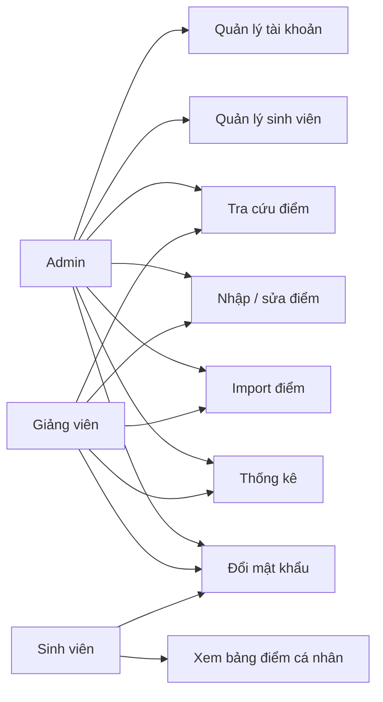
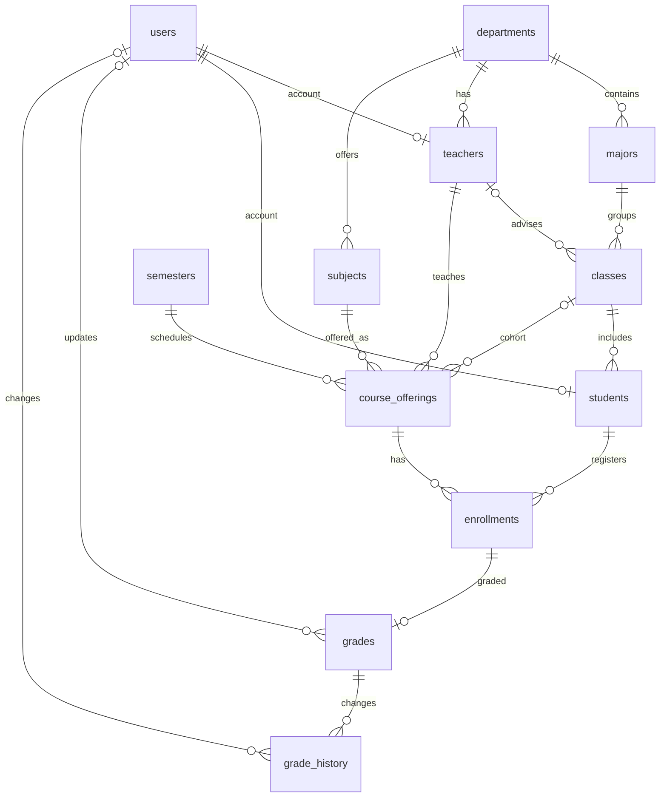
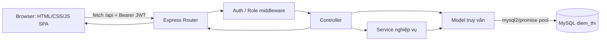
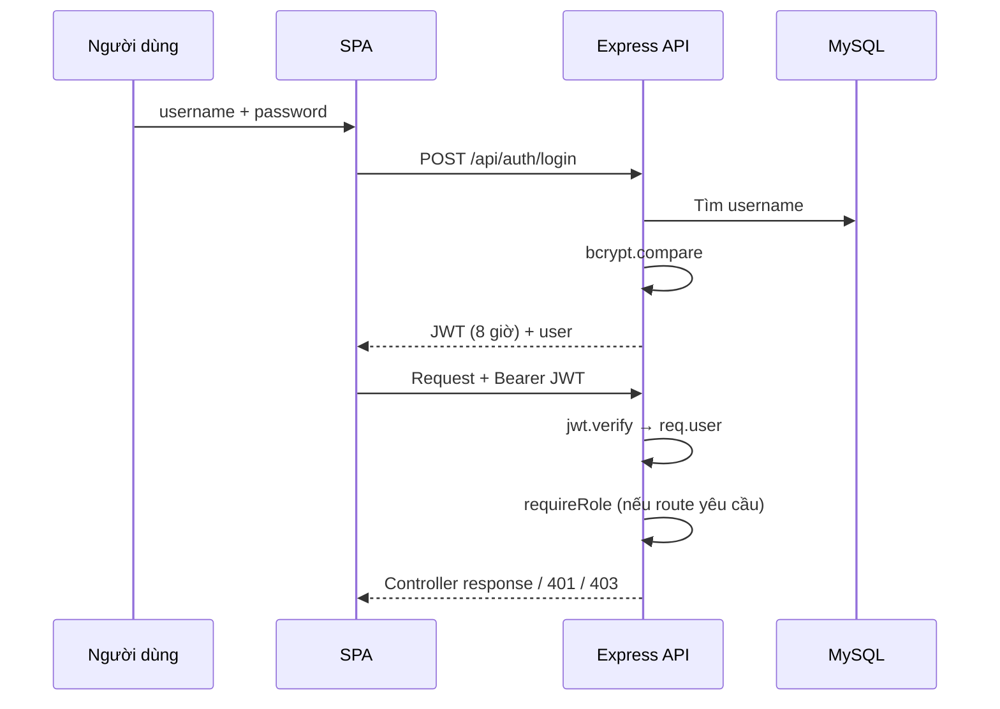

# Nội dung thuyết trình báo cáo cuối kỳ

> **Cập nhật 08/11/2026:** Dự án hiện chỉ dùng React. Nội dung mô tả frontend cũ, yêu cầu giữ bản cũ và kết quả rollback bên dưới là hồ sơ lịch sử trước khi gỡ bản cũ, không phải hướng dẫn chạy hiện hành. Xem [README](../README.md), [frontend React](../fe-react/README.md) và [slide React 12–22](./noi-dung-slide-12-22.md). Các liên kết mã frontend cũ trỏ tới commit lưu trữ.

> Căn cứ mã nguồn trong workspace hiện tại. Tên đề tài, thông tin lớp/giảng viên, thời gian triển khai và kết quả kiểm thử chưa được chứng minh bằng code đều được đánh dấu `[CẦN BỔ SUNG]`. README ghi website tra cứu kết quả thi; triển khai thực tế là SPA quản lý/tra cứu điểm với ba vai trò. Schema có 12 bảng, không phải 10. Dự án không có `design-system.css` hay `data.js`; stylesheet là `fe/css/style.css`, dữ liệu trang tải qua API.

## Dữ kiện đã xác minh

| Mục | Giá trị | File nguồn |
|---|---|---|
| Cấu trúc | `be/` (routes, controllers, models, services, middleware, config); `database/` (SQL, seed); `fe/` (SPA, pages, CSS, JS). | `README.md`; `be/`; `database/`; `fe/` |
| Backend và thư viện | Express 4.19.2, mysql2 3.11.0, jsonwebtoken 9.0.2, bcryptjs 2.4.3, dotenv 16.4.5, xlsx 0.18.5, multer 1.4.5-lts.1, cors 2.8.5. Node.js. | `be/package.json` |
| CSDL | MySQL, database `diem_thi`; 12 bảng: departments, majors, users, teachers, classes, students, subjects, semesters, course_offerings, enrollments, grades, grade_history. PK đều `id`; FK/quan hệ chính xem Slide 8. | `database/02_schema.sql:14–271` |
| API | 27 route khai báo: auth 3, students 6, stats 5, admin 3, nghiệp vụ điểm 10. Tất cả trừ login cần JWT; giới hạn role theo route. | `be/routes/*.js`; `be/server.js` |
| Auth | JWT mang id/role/username, hết hạn 8 giờ; Bearer token; `auth` trả 401 khi thiếu/sai/hết hạn; `requireRole` trả 403. bcryptjs compare khi đăng nhập, hash cost 10 khi đổi mật khẩu. | `be/middleware/auth.js:4–14`; `be/controllers/authController.js:10,30` |
| Cấu hình | dotenv nạp biến môi trường; MySQL pool dùng DB_HOST/PORT/USER/PASSWORD/NAME; JWT_SECRET. Tệp mẫu có sẵn; không đưa giá trị bí mật vào slide. | `be/server.js`; `be/config/db.js`; `be/.env.example` |
| Frontend | SPA một khung `fe/index.html`, router hash và render trong `fe/js/app.js`; HTML template tại `fe/pages/`; các view gọi `/api` qua fetch. Không tìm thấy `data.js`. | `fe/index.html`; `fe/js/app.js`; `fe/pages/` |
| Màn hình thực | Login, dashboard, my transcript, lookup, nhập điểm, import Excel, danh sách điểm/lịch sử, thống kê, quản lý SV, quản lý tài khoản, đổi mật khẩu. Định hướng tám màn hình không khớp nguyên trạng. | `fe/js/app.js`; `fe/pages/*.html` |
| UI | Màu chính #3b82f6; nền #f1f5f9; chữ #0f172a; font Inter/system-ui; card, stat, form, button, badge, table, pager, toast, modal. | `fe/css/style.css` |
| Điểm | 0–10, tối đa 2 chữ số; CK bắt buộc, CC/GK tùy chọn. Thiếu CC hoặc GK thì tổng điểm bằng CK; nếu đủ thì 10%/30%/60%. Đạt từ 5; GPA trung bình có trọng số tín chỉ. | `be/utils/grade.js:5–22`; `be/controllers/gradesController.js:40–46`; `be/models/studentModel.js:7–28` |
| Git | 52 commit trên toàn bộ refs; branch local `main`, remote `origin/main`, `origin/HEAD`. `git shortlog -sn`: PHAM DANG KHOA 50; Qangter 1; gitacKhoa 1. Không suy ra được phân công từ số commit. | `git branch -a`; `git rev-list --count --all`; `git shortlog -sn --all` |
| Các mốc Git | 30/09/2026 “Update project”; 02/10 “MVC”; 09/10 “sua giao dien lan 2”, “logo”; 11/10 checkpoint. Nhiều commit gần đây là checkpoint tự động, không phải mốc tính năng tin cậy. | `git log --all --reverse`; `git log --all` |
| Bối cảnh học phần | Tên chính thức đề tài, môn/lớp, giảng viên, tên thành viên và phân công: `[CẦN BỔ SUNG]`. Thông tin Khoa/ngành/UIUX là thông tin người dùng cung cấp, chưa xác minh độc lập qua code. | `[CẦN BỔ SUNG]` |

## Slide 1 — Trang bìa

**Nội dung hiển thị**
- Hệ thống Thông tin Học vụ `[CẦN BỔ SUNG: xác nhận tên đề tài]`
- Báo cáo đồ án nhóm — Lập trình Web, PTIT `[CẦN BỔ SUNG: lớp]`
- Nhóm: `[CẦN BỔ SUNG: tên nhóm]` · Thành viên: `[CẦN BỔ SUNG: họ tên]`
- Giảng viên hướng dẫn: `[CẦN BỔ SUNG]`

**Gợi ý hình:** Logo hiện có tại `fe/assets/images/logo.png`, ảnh chụp trang đăng nhập.

**Lời thuyết trình (Khoa; 60–90 từ):** Kính chào thầy cô và các bạn. Nhóm xin trình bày sản phẩm web quản lý và tra cứu điểm học phần với ba vai trò quản trị viên, giảng viên và sinh viên. Phần trình bày đi từ bài toán, thiết kế và kiến trúc đến luồng xử lý điểm, bảo mật và kết quả hiện có. Tên đề tài, thành viên và giảng viên trên trang bìa sẽ được nhóm bổ sung theo thông tin chính thức của lớp.

**Thời lượng:** 0:30. **Nguồn:** `README.md`; `fe/index.html`; `fe/assets/images/logo.png`.

## Slide 2 — Bố cục bài thuyết trình

**Nội dung hiển thị**
- Bài toán, phạm vi và quy trình phát triển
- Thiết kế giao diện, use case và cơ sở dữ liệu
- Kiến trúc, frontend, API và bảo mật
- Nghiệp vụ điểm, kết quả, hạn chế và định hướng

**Gợi ý hình:** Lộ trình 4 chặng theo các cụm nội dung của slide.

**Lời thuyết trình (Khoa; 60–90 từ):** Báo cáo gồm bốn phần. Trước hết, nhóm nêu bài toán và phạm vi người dùng. Tiếp theo là ba nội dung thiết kế được trình bày riêng: giao diện, use case và cơ sở dữ liệu. Phần trọng tâm kỹ thuật giải thích kiến trúc, cách xây dựng SPA và API, cơ chế xác thực cùng quy tắc tính điểm. Cuối cùng, nhóm tổng kết phần đã triển khai, nêu hạn chế và trả lời câu hỏi. Các số liệu trong báo cáo được lấy từ repository hiện tại.

**Thời lượng:** 0:30. **Nguồn:** `README.md`; `be/`; `fe/`; `database/`.

## Slide 3 — Đặt vấn đề và mục tiêu

**Nội dung hiển thị**
- Tập trung thông tin lớp học phần, điểm và lịch sử điểm
- Hỗ trợ nhân sự tra cứu, cập nhật và tổng hợp điểm
- Sinh viên tra cứu bảng điểm cá nhân theo học kỳ
- Mục tiêu vận hành và tiêu chí nghiệm thu: `[CẦN BỔ SUNG]`

**Gợi ý hình:** Luồng dữ liệu sinh viên → lớp học phần → điểm → bảng điểm; ảnh trang tra cứu.

**Lời thuyết trình (Khoa; 60–90 từ):** Mã nguồn tổ chức dữ liệu học vụ quanh sinh viên, lớp học phần, đăng ký và điểm. Nhân sự được phân quyền để tra cứu, ghi nhận hoặc tổng hợp; sinh viên xem bảng điểm của chính mình. Đây là mục tiêu có thể quan sát trực tiếp trong API và giao diện. Những lợi ích định lượng như rút ngắn thời gian xử lý hay giảm sai sót chưa được đo trong repository, vì vậy nhóm cần bổ sung số liệu đánh giá nếu muốn khẳng định các kết quả đó.

**Thời lượng:** 0:55. **Nguồn:** `database/02_schema.sql`; `be/routes/students.js`; `fe/js/app.js`.

## Slide 4 — Phạm vi và ba vai trò người dùng

**Nội dung hiển thị**
- Admin: quản lý sinh viên/tài khoản; tra cứu, nhập và thống kê điểm
- Giảng viên: tra cứu, nhập điểm và xem thống kê lớp được dạy
- Sinh viên: xem bảng điểm cá nhân và đổi mật khẩu
- Quản lý môn/giảng viên CRUD: chưa thấy API hoặc màn hình tương ứng

**Gợi ý hình:** Bảng chức năng theo vai trò; minh họa bằng danh sách menu lọc role.

**Lời thuyết trình (Khoa; 60–90 từ):** Phạm vi được xác định theo quyền thực thi ở server. Admin có thêm quản lý tài khoản và hồ sơ sinh viên. Admin và giảng viên dùng các API điểm, import và thống kê; riêng giảng viên bị giới hạn theo lớp học phần được phân công ở thao tác điểm. Sinh viên chỉ truy cập bảng điểm của tài khoản mình và đổi mật khẩu. Danh sách tám màn hình dự kiến có mục quản lý môn và giảng viên, nhưng các chức năng CRUD này không có trong route và menu hiện tại.

**Thời lượng:** 1:00. **Nguồn:** `be/routes/admin.js`; `be/routes/students.js`; `be/routes/grades.js`; `be/routes/stats.js`; `fe/js/app.js`.

## Slide 5 — Quy trình phát triển dự án

**Nội dung hiển thị**
- Khảo sát & phân tích → yêu cầu/phạm vi `[CẦN BỔ SUNG: đầu ra, phụ trách]`
- Thiết kế → schema/CSS; Frontend → SPA/pages `[CẦN BỔ SUNG: phụ trách]`
- Backend & CSDL → routes/schema; tích hợp & kiểm thử → `[CẦN BỔ SUNG]`
- Hoàn thiện & báo cáo → `[CẦN BỔ SUNG: đầu ra, phụ trách]`; Git: 30/09–11/10/2026

**Gợi ý hình:** Timeline sáu giai đoạn; gắn mốc Git đã xác minh, phân biệt ngày commit với thời gian làm.

**Lời thuyết trình (Khoa; 60–90 từ):** Timeline thể hiện quy trình báo cáo cần trình bày, còn repository chỉ xác nhận được một số mốc commit. Ngày 30 tháng 9 có commit “Update project”, ngày 2 tháng 10 có “MVC”, ngày 9 tháng 10 có cập nhật giao diện và logo; ngày 11 tháng 10 xuất hiện checkpoint. Các commit không ghi đầy đủ đầu ra, ngày bắt đầu/kết thúc từng giai đoạn hay người phụ trách. Nhóm cần đối chiếu lịch sử làm việc hoặc biên bản nhóm trước khi gán các mốc này cho từng giai đoạn.

**Thời lượng:** 1:00. **Nguồn:** `git log --all --reverse`; `git log --all`; `be/`; `fe/`; `database/`.

## Slide 6 — Thiết kế giao diện

**Nội dung hiển thị**
- SPA theo hash route, khung điều hướng dùng chung
- Tông xanh #3b82f6, nền #f1f5f9, font Inter
- Tái sử dụng card, stat, form, badge, bảng, phân trang, modal
- Wireframe/mockup ban đầu: `[CẦN BỔ SUNG]`

**Gợi ý hình:** Chụp trang đăng nhập và dashboard; tô chú thích sidebar, thẻ thống kê, bảng. Không có tệp wireframe/mockup trong repository.

**Lời thuyết trình (Khoa; 60–90 từ):** Giao diện dùng một khung SPA và các HTML template nạp theo từng view. Hệ thống màu tập trung vào xanh dương, nền xám sáng và font Inter; CSS định nghĩa các thành phần như thẻ thống kê, bảng, huy hiệu trạng thái, nút và biểu mẫu. Điều này giữ cách trình bày nhất quán giữa các trang. Repository hiện chỉ có mã giao diện hoàn thiện, không có wireframe hay mockup để chứng minh quy trình thiết kế ban đầu; nhóm có thể bổ sung ảnh nếu còn lưu.

**Thời lượng:** 0:55. **Nguồn:** `fe/css/style.css:1–19,77–123`; `fe/js/app.js:269–340,833–845`; `fe/pages/common.html`; `fe/index.html`.

## Slide 7 — Use case và kịch bản chức năng

**Nội dung hiển thị**
- Admin: quản lý sinh viên/tài khoản; tra cứu và cập nhật điểm
- Giảng viên: xem lớp phụ trách; nhập, sửa và import điểm
- Sinh viên: xem bảng điểm cá nhân
- Quyền route được kiểm tra ở backend

**Gợi ý sơ đồ (Mermaid):**



Kịch bản nhập điểm: chọn lớp học phần → xác minh quyền giảng viên → kiểm tra điểm → lưu giao dịch → trả tổng và điểm chữ. Kịch bản tra cứu: sinh viên gọi bảng điểm của mình; server lấy student_id từ phiên đăng nhập.

**Lời thuyết trình (Khoa; 60–90 từ):** Sơ đồ tóm tắt các chức năng thực tế, không đưa vào quản lý môn hay giảng viên vì route tương ứng chưa tồn tại. Khi nhập điểm, backend kiểm tra quyền lớp học phần, xác thực các điểm thành số trong khoảng 0–10 rồi cập nhật trong transaction. Khi sinh viên tra cứu, endpoint dùng danh tính trong JWT để lấy đúng hồ sơ gắn với tài khoản, thay vì tin một mã sinh viên tùy ý từ trình duyệt. Hai kịch bản này minh họa cả luồng dùng và ranh giới quyền.

**Thời lượng:** 1:05. **Nguồn:** `be/routes/grades.js`; `be/routes/students.js`; `be/controllers/gradesController.js`; `be/controllers/studentsController.js`.

## Slide 8 — Thiết kế cơ sở dữ liệu

**Nội dung hiển thị**
- 12 bảng; `id` là PK; FK liên kết hồ sơ, lớp học và điểm
- Một môn mở theo học kỳ, giảng viên, lớp thành lớp học phần
- Enrollment nối sinh viên với lớp học phần; grades gắn enrollment
- grade_history ghi nhận thay đổi tổng điểm

**Gợi ý sơ đồ ERD (Mermaid):**



**Lược đồ trường chính:** departments(id, department_code, department_name); majors(id, department_id, major_code, major_name); users(id, username, password_hash, role); teachers(id, user_id, department_id, teacher_code); classes(id, major_id, advisor_teacher_id, class_code); students(id, user_id, class_id, student_code); subjects(id, department_id, subject_code, credits); semesters(id, semester_code, academic_year); course_offerings(id, subject_id, semester_id, teacher_id, class_id); enrollments(id, student_id, course_offering_id); grades(id, enrollment_id, các điểm, total_score, letter_grade, result); grade_history(id, grade_id, old_score, new_score, changed_by). Mỗi bảng còn có cột bổ sung trong schema.

**Lời thuyết trình (Khoa; 60–90 từ):** Schema gồm 12 bảng. Các khóa ngoại biểu diễn chuỗi tổ chức khoa/ngành/lớp, hồ sơ tài khoản, và nghiệp vụ môn học theo học kỳ. Enrollment giải quyết quan hệ nhiều-nhiều giữa sinh viên và lớp học phần; mỗi enrollment có tối đa một bản ghi điểm. Bảng lịch sử liên kết với grades để lưu điểm cũ/mới và người thay đổi. Ràng buộc unique ngăn trùng mã và đăng ký trùng; ràng buộc check kiểm tra tín chỉ, ngày học kỳ và miền điểm.

**Thời lượng:** 1:05. **Nguồn:** `database/02_schema.sql:14–271` (12 lệnh CREATE TABLE, FK/UNIQUE/CHECK).

## Slide 9 — Công nghệ và kiến trúc hệ thống

**Nội dung hiển thị**
- Client: HTML/CSS/JavaScript thuần, SPA và fetch API
- Server: Node.js + Express, route → controller → model/service
- MySQL qua mysql2/promise connection pool
- Vì sao: ít tầng triển khai, phân tách HTTP, nghiệp vụ, truy vấn

**Gợi ý sơ đồ kiến trúc (Mermaid):**



**Lời thuyết trình (Khoa; 60–90 từ):** Trình duyệt tải SPA tĩnh từ Express, sau đó gọi các endpoint `/api`. Router chọn controller và middleware; controller điều phối logic, service dùng chung xử lý lưu điểm, model truy vấn MySQL qua pool. Bộ công nghệ là HTML/CSS/JavaScript thuần ở client, Express/Node.js ở server và MySQL ở tầng lưu trữ. Cấu trúc này phù hợp với quy mô đồ án và giúp tách trách nhiệm theo thư mục; đây là lý do kiến trúc, không phải kết quả benchmark hiệu năng.

**Thời lượng:** 1:00. **Nguồn:** `be/server.js:11–19`; `be/routes/`; `be/controllers/`; `be/services/gradeService.js`; `be/models/`; `be/config/db.js`; `fe/js/app.js:63–83`.

## Slide 10 — Triển khai Frontend

**Nội dung hiển thị**
- Login → `login.html`; dashboard → `dashboard.html`
- Tra cứu SV → `lookup.html`; nhập điểm → `entry.html`
- Điểm SV → `transcript.html`; thống kê → `stats.html`
- Quản lý SV → `students.html`; quản lý tài khoản → `users.html`
- Các view tải API; không có `data.js` trong mã hiện tại

**Gợi ý hình:** Sơ đồ `index.html → app.js router → pages/*.html templates → fetch('/api…') → DOM`.

**Lời thuyết trình (Khoa; 60–90 từ):** Tám màn hình được đối chiếu theo các trang có thật: đăng nhập, dashboard, tra cứu, nhập điểm, bảng điểm cá nhân, thống kê, quản lý sinh viên và quản lý tài khoản. Trong code, chúng không phải tám ứng dụng riêng mà là view của SPA nạp HTML template. Hàm api trong app.js dùng fetch tới backend, còn dữ liệu được dựng vào DOM từ phản hồi. Repository không chứa `data.js`; do đó không có bằng chứng về các màn hình còn dùng bộ dữ liệu giả theo cách mô tả ban đầu.

**Thời lượng:** 0:55. **Nguồn:** `fe/index.html`; `fe/js/app.js`; `fe/pages/login.html`; `dashboard.html`; `lookup.html`; `entry.html`; `transcript.html`; `stats.html`; `students.html`; `users.html`.

## Slide 11 — Demo giao diện

**Nội dung hiển thị**
- Nhập điểm inline: bảng lớp học phần và phản hồi lưu
- Bảng điểm sinh viên: học kỳ, điểm tổng kết, GPA thang 10
- Dashboard admin: chỉ số tổng quan và biểu đồ thống kê
- Ảnh chụp cần thực hiện khi chạy ứng dụng: `[CẦN BỔ SUNG]`

**Gợi ý hình:** Chụp `fe/pages/entry.html` sau khi chọn lớp; `fe/pages/transcript.html` ở vai trò STUDENT; `fe/pages/dashboard.html` ở vai trò ADMIN. Đây là tệp nguồn giao diện, không phải ảnh chụp sẵn.

**Lời thuyết trình (Khoa; 60–90 từ):** Phần demo tập trung vào ba thao tác dễ quan sát. Đầu tiên, mở trang nhập điểm, chọn lớp học phần và sửa điểm trực tiếp trên hàng; sau khi lưu, giao diện nhận tổng điểm và điểm chữ từ API. Tiếp theo đăng nhập sinh viên để xem bảng điểm cá nhân theo học kỳ và giá trị trung bình. Cuối cùng đăng nhập Admin để xem dashboard tổng quan. Ảnh minh họa cần chụp từ ứng dụng đang chạy vì repository hiện chỉ có HTML/CSS/JS nguồn.

**Thời lượng:** 1:10. **Nguồn:** `fe/pages/entry.html`; `fe/pages/transcript.html`; `fe/pages/dashboard.html`; `fe/js/app.js`.

## Slide 12 — Triển khai Backend và API

**Nội dung hiển thị**
- 27 endpoint: auth 3 · students 6 · stats 5 · admin 3 · điểm 10
- Admin/Teacher: thống kê, tra cứu và thao tác điểm theo quyền
- Student: bảng điểm của mình; Admin: quản lý hồ sơ/tài khoản
- Vì sao: route tách nhóm, middleware áp chính sách tập trung

**Gợi ý hình:** Biểu đồ thanh số endpoint theo nhóm; endpoint chi tiết ở phụ lục A.

**Lời thuyết trình (Khoa; 60–90 từ):** Theo các khai báo route hiện tại, backend có 27 tổ hợp method/path: ba xác thực, sáu sinh viên, năm thống kê, ba quản trị tài khoản và mười endpoint metadata/lớp học phần/điểm/import. Route thống kê dùng chung quyền Admin và Teacher; route quản trị chỉ Admin; bảng điểm cá nhân chỉ Student. Tầng route gắn middleware trước controller, làm rõ quyền ở mỗi nhóm chức năng. Con số này đếm route khai báo, không phải số lần gọi hay phép đo độ phủ kiểm thử.

**Thời lượng:** 0:55. **Nguồn:** `be/routes/auth.js`; `students.js`; `stats.js`; `admin.js`; `grades.js`; `be/server.js`.

## Slide 13 — Xác thực và phân quyền

**Nội dung hiển thị**
- Đăng nhập so sánh bcrypt hash; JWT ký với thời hạn 8 giờ
- Client gửi `Authorization: Bearer`; verify token trước controller
- requireRole: 401 chưa hợp lệ; 403 không đủ vai trò
- Vì sao: xác minh danh tính và quyền ở phía server

**Minh họa code (6 dòng):**

```js
const sign = u => jwt.sign({ id: u.id, role: u.role, username: u.username }, SECRET, { expiresIn: '8h' });
const token = h.startsWith('Bearer ') ? h.slice(7) : null;
if (!token) return res.status(401).json({ message: 'Chưa đăng nhập' });
try { req.user = jwt.verify(token, SECRET); next(); }
catch { res.status(401).json({ message: 'Phiên không hợp lệ hoặc hết hạn' }); }
```

**Gợi ý sơ đồ (Mermaid):**



**Lời thuyết trình (Khoa; 60–90 từ):** Khi đăng nhập, backend tìm tài khoản và dùng bcryptjs compare mật khẩu nhập với hash lưu trong CSDL. Nếu hợp lệ, JWT chứa id, role và username, có thời hạn tám giờ. Client gửi token dưới dạng Bearer. Middleware xác minh chữ ký và thời hạn trước khi gắn danh tính vào request; requireRole kiểm tra danh sách vai trò cho endpoint. Thiếu hoặc token sai nhận 401, còn vai trò không phù hợp nhận 403. Cấu hình secret được lấy từ biến môi trường.

**Thời lượng:** 1:10. **Nguồn:** `be/controllers/authController.js:5–30`; `be/middleware/auth.js:4–14`; `be/.env.example` (tệp mẫu); `be/server.js:1`.

## Slide 14 — Xử lý nghiệp vụ nổi bật: nhập điểm và GPA

**Nội dung hiển thị**
- Điểm hợp lệ 0–10; làm tròn hai chữ số; cuối kỳ bắt buộc
- Đủ CC/GK/CK: 0,1 × CC + 0,3 × GK + 0,6 × CK
- Thiếu CC hoặc GK: tổng điểm bằng điểm cuối kỳ
- Đạt từ 5; lưu lịch sử khi tổng điểm thay đổi
- GPA thang 10: trung bình tổng điểm có trọng số tín chỉ

**Gợi ý hình:** Thẻ công thức và ví dụ số minh họa do nhóm tự chọn, ghi nhãn giả lập; không gán là kết quả kiểm thử.

**Lời thuyết trình (Khoa; 60–90 từ):** Hàm parseScore chấp nhận giá trị số từ 0 đến 10, hỗ trợ dấu phẩy thập phân và làm tròn hai chữ số. Điểm cuối kỳ bắt buộc; chuyên cần và giữa kỳ có thể để trống. Khi cả ba thành phần có mặt, công thức áp trọng số 10%, 30%, 60%; nếu thiếu một trong hai thành phần đầu, code dùng điểm cuối kỳ làm tổng. Mốc đạt là 5. GPA bảng điểm được tính bằng tổng điểm nhân tín chỉ chia tổng tín chỉ, rồi làm tròn hai chữ số.

**Thời lượng:** 1:10. **Nguồn:** `be/utils/grade.js:5–22`; `be/controllers/gradesController.js:40–46`; `be/services/gradeService.js:4–24`; `be/models/studentModel.js:7–28`.

## Slide 15 — Cộng tác nhóm và quản lý mã nguồn

**Nội dung hiển thị**
- Nhánh quan sát được: `main`, `origin/main`; không thấy `dev`/`feature`
- 52 commit toàn refs; shortlog: PHAM DANG KHOA 50, hai tên khác 1
- README hướng dẫn sao chép `.env.example`; không công khai cấu hình thật
- Phân công hai thành viên và quy trình merge: `[CẦN BỔ SUNG]`

**Gợi ý hình:** Git timeline 30/09 → 02/10 → 09/10 → 11/10; biểu đồ commit có chú thích danh tính Git không xác nhận thành viên.

**Lời thuyết trình (Khoa; 60–90 từ):** Lịch sử hiện tại cho thấy nhánh local main cùng remote origin/main; không thấy nhánh dev hay feature. Có 52 commit trên toàn bộ refs. Shortlog ghi 50 commit dưới tên PHAM DANG KHOA và một commit cho mỗi hai định danh khác. Đây chỉ là metadata tác giả Git, không chứng minh số người thực hiện hoặc phân công công việc. README hướng dẫn dùng `.env.example` để tạo cấu hình cục bộ. Quy trình feature → dev → main và xử lý unrelated histories cần được xác nhận từ thành viên.

**Thời lượng:** 0:55. **Nguồn:** `git branch -a`; `git rev-list --count --all`; `git shortlog -sn --all`; `README.md`; `be/.env.example`.

## Slide 16 — Kiểm thử, kết quả, hạn chế và hướng phát triển

**Nội dung hiển thị**
- Có SQL seed/verify và truy vấn mẫu; kết quả chạy kiểm thử: `[CẦN BỔ SUNG]`
- Chưa có bằng chứng test tự động trong cấu trúc repository
- Hạn chế xác minh: chưa có CRUD môn học/giảng viên trong API
- Hướng tiếp theo cần thống nhất với tiêu chí học phần: `[CẦN BỔ SUNG]`

**Gợi ý hình:** Bảng “đã có trong code / cần kiểm chứng khi chạy”; không dùng số lượng seed README như kết quả test.

**Lời thuyết trình (Khoa; 60–90 từ):** Repository có script tạo dữ liệu, truy vấn kiểm tra SQL và API để phục vụ các luồng chính. Tuy nhiên, chỉ từ các file này không thể kết luận toàn bộ chức năng đã được kiểm thử thành công. Chưa thấy thư mục hay tệp test tự động trong danh sách dự án; kiểm thử thủ công và lỗi đã gặp cần được nhóm bổ sung bằng biên bản hoặc ảnh chụp. Hạn chế có thể xác nhận là thiếu API/màn hình quản lý môn học và giảng viên, dù hai mục xuất hiện trong thông tin định hướng.

**Thời lượng:** 1:00. **Nguồn:** `database/verify.sql`; `database/example_queries.sql`; `database/*seed*.sql`; `be/routes/`; `fe/pages/`.

## Slide 17 — Kết luận và hỏi đáp

**Nội dung hiển thị**
- Sản phẩm hiện thực hóa luồng tài khoản, lớp học phần và điểm
- Ba vai trò có quyền khác nhau ở backend
- Cảm ơn thầy cô và các bạn
- Q&A

**Gợi ý hình:** Sơ đồ tóm tắt người dùng → API → CSDL; giữ logo ở chân trang.

**Lời thuyết trình (Khoa; 60–90 từ):** Nhóm đã xây dựng một ứng dụng web có ba vai trò, API phân quyền, schema quan hệ và luồng nhập/tra cứu điểm. Phần trình bày tập trung vào những hành vi có thể đối chiếu với mã nguồn, đồng thời đánh dấu các thông tin cần nhóm xác nhận như phân công và kết quả kiểm thử. Nhóm xin cảm ơn thầy cô và các bạn đã lắng nghe. Chúng em sẵn sàng trao đổi về thiết kế dữ liệu, xác thực JWT, kiểm tra quyền và công thức nghiệp vụ.

**Thời lượng:** 0:35. **Nguồn:** `be/`; `database/02_schema.sql`; `fe/`.

## Phụ lục A — Bảng API đầy đủ

| Method | Endpoint | Vai trò | Controller |
|---|---|---|---|
| POST | `/api/auth/login` | Công khai | authController.login |
| GET | `/api/auth/me` | JWT | authController.me |
| POST | `/api/auth/change-password` | JWT | authController.changePassword |
| GET | `/api/students/me/transcript` | STUDENT | studentsController.myTranscript |
| GET | `/api/students` | ADMIN, TEACHER | studentsController.list |
| GET | `/api/students/:id/transcript` | ADMIN, TEACHER | studentsController.transcript |
| POST | `/api/students` | ADMIN | studentsController.create |
| PUT | `/api/students/:id` | ADMIN | studentsController.update |
| DELETE | `/api/students/:id` | ADMIN | studentsController.remove |
| GET | `/api/stats/overview` | ADMIN, TEACHER | statsController.overview |
| GET | `/api/stats/by-subject` | ADMIN, TEACHER | statsController.bySubject |
| GET | `/api/stats/by-semester` | ADMIN, TEACHER | statsController.bySemester |
| GET | `/api/stats/distribution` | ADMIN, TEACHER | statsController.distribution |
| GET | `/api/stats/by-department` | ADMIN, TEACHER | statsController.byDepartment |
| GET | `/api/admin/users` | ADMIN | adminController.listUsers |
| PATCH | `/api/admin/users/:id/active` | ADMIN | adminController.setActive |
| POST | `/api/admin/users/:id/reset-password` | ADMIN | adminController.resetPassword |
| GET | `/api/meta` | JWT | gradesController.meta |
| GET | `/api/offerings` | ADMIN, TEACHER | gradesController.offerings |
| GET | `/api/offerings/:id/students` | ADMIN, TEACHER; GV chỉ lớp mình | gradesController.offeringStudents |
| POST | `/api/offerings/:id/enroll` | ADMIN, TEACHER; GV chỉ lớp mình | gradesController.enroll |
| PUT | `/api/grades/enrollment/:enrollmentId` | ADMIN, TEACHER; GV chỉ lớp mình | gradesController.updateGrade |
| DELETE | `/api/grades/:id` | ADMIN, TEACHER; GV chỉ lớp mình | gradesController.deleteGrade |
| GET | `/api/grades/:id/history` | ADMIN, TEACHER | gradesController.gradeHistory |
| GET | `/api/grades` | ADMIN, TEACHER | gradesController.listGrades |
| GET | `/api/import/template` | ADMIN, TEACHER | gradesController.importTemplate |
| POST | `/api/import/grades` | ADMIN, TEACHER | gradesController.importGrades |

**Lưu ý:** Endpoint lịch sử điểm và danh sách điểm yêu cầu staff nhưng không gọi `assertOfferingAccess` trong route/controller hiện tại. Nhóm nên rà soát giới hạn theo giảng viên trước khi tuyên bố các API này chỉ trả lớp được phân công.

## Phụ lục B — Cấu trúc thư mục

```text
be/
  config/db.js
  controllers/{admin,auth,grades,stats,students}Controller.js
  middleware/auth.js
  models/{admin,grade,stats,student,user}Model.js
  routes/{admin,auth,grades,stats,students}.js
  services/gradeService.js
  utils/grade.js
  server.js
  package.json
database/
  01_create_database.sql
  02_schema.sql
  03...12_seed_*.sql
  full_setup.sql, verify.sql, example_queries.sql
fe/
  index.html
  css/style.css
  js/app.js
  pages/*.html
  pages/modals/*.html
```

## Sáu câu hỏi hội đồng và gợi ý trả lời

1. **JWT được tạo và kiểm tra thế nào?** Khi đăng nhập thành công, backend ký JWT có id, role, username; thời hạn cấu hình là 8 giờ. Request gửi Bearer token; middleware verify trước controller. ( `be/middleware/auth.js`, `be/controllers/authController.js` )
2. **Phân quyền được thực hiện ở đâu?** `requireRole` đối chiếu role trong token; route gắn middleware theo nhóm quyền. Một số thao tác điểm còn kiểm tra giảng viên có phụ trách lớp học phần hay không. ( `be/routes/*.js`, `be/controllers/gradesController.js` )
3. **Vì sao tách enrollments khỏi grades?** Enrollment nối sinh viên với lớp học phần và có unique cặp sinh viên/lớp; grades tham chiếu enrollment, tách thông tin đăng ký khỏi kết quả học tập. ( `database/02_schema.sql` )
4. **Vì sao không dùng framework frontend?** Code hiện dùng SPA JavaScript thuần, fetch, hash router và HTML template. Có thể giải thích lựa chọn phù hợp phạm vi đồ án; lý do lịch sử/chính thức của nhóm cần xác nhận. ( `fe/js/app.js`, `fe/pages/` )
5. **GPA được tính như thế nào?** Bảng điểm lấy tổng `total_score × credits` chia tổng tín chỉ của các môn có điểm, làm tròn hai chữ số; có thể lọc theo học kỳ. Công thức thành phần điểm môn nằm ở `be/utils/grade.js`.
6. **Đã kiểm thử những gì và đạt kết quả ra sao?** Repository có SQL seed/verify và luồng API; không có bằng chứng kết quả test tự động hay biên bản thủ công. Trình bày kết quả chỉ sau khi chạy và ghi nhận, hiện đánh dấu `[CẦN BỔ SUNG]`.

## Danh sách mục [CẦN BỔ SUNG]

- Xác nhận tên đề tài chính thức, tên nhóm, lớp/mã lớp, giảng viên hướng dẫn.
- Họ tên thành viên; người trình bày từng phần; phân công công việc đã thống nhất.
- Thời gian thực tế, đầu ra và người phụ trách từng giai đoạn timeline.
- Wireframe/mockup hoặc bằng chứng quy trình thiết kế trước khi code.
- Ảnh chụp ứng dụng đang chạy cho demo ba vai trò.
- Kết quả kiểm thử thủ công/tự động, môi trường, lỗi và cách xử lý.
- Tiêu chí nghiệm thu, số liệu hiệu quả, hạn chế đã biết và hướng phát triển được nhóm duyệt.
- Xác nhận Git workflow `feature → dev → main`, đóng góp thực tế của từng thành viên và việc xử lý `--allow-unrelated-histories`; Git metadata hiện không chứng minh các nội dung này.
- Quyết định có đưa quản lý môn học/giảng viên vào phạm vi báo cáo hay ghi là chưa triển khai.
